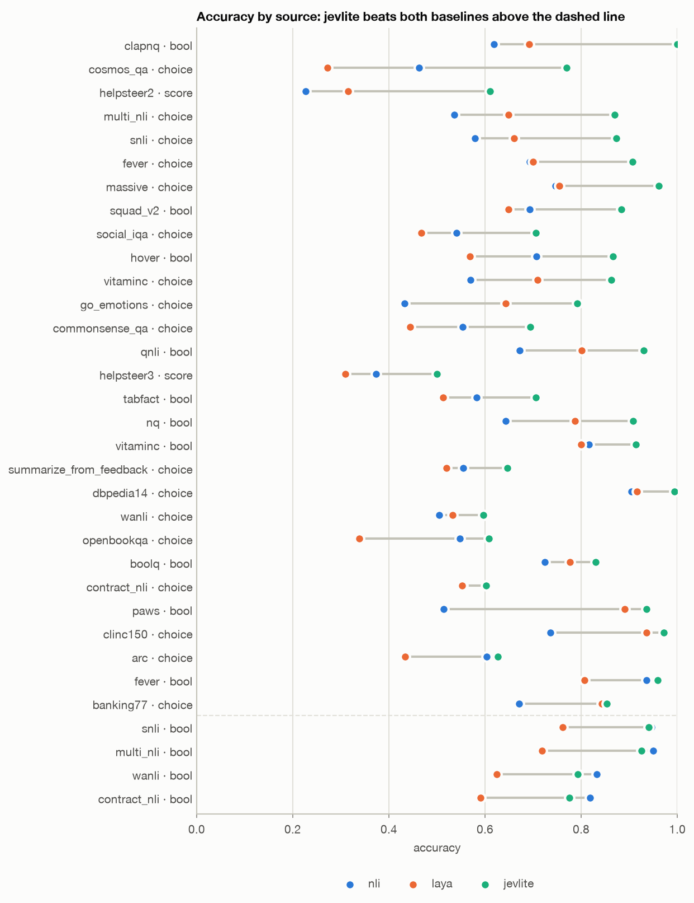
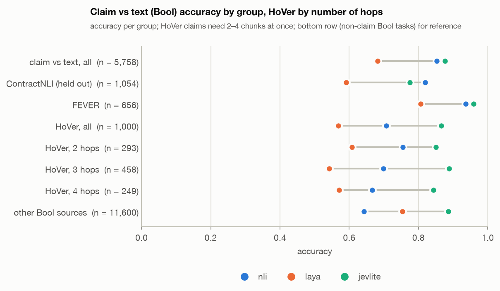
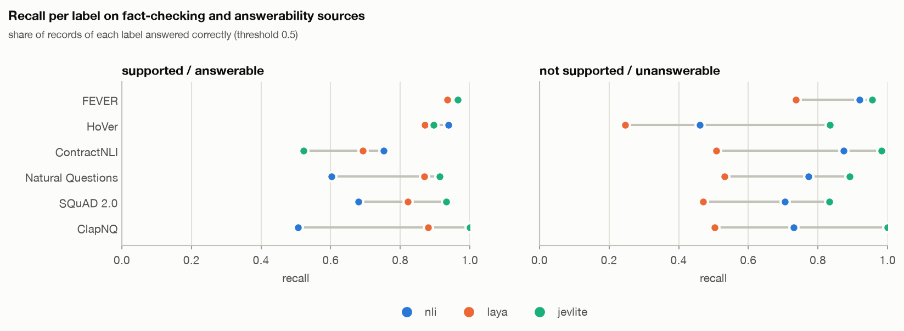
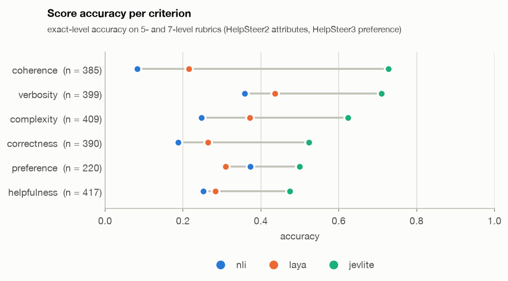
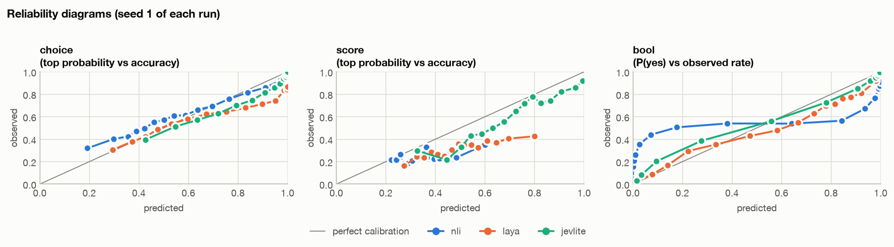
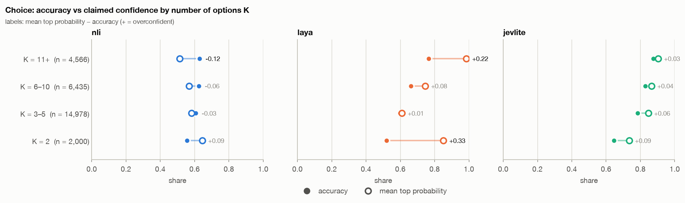
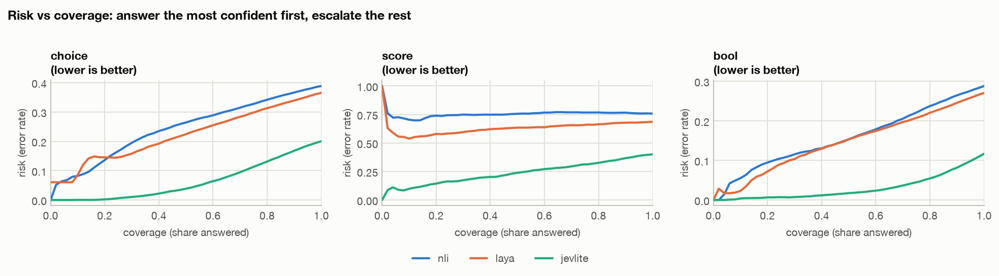
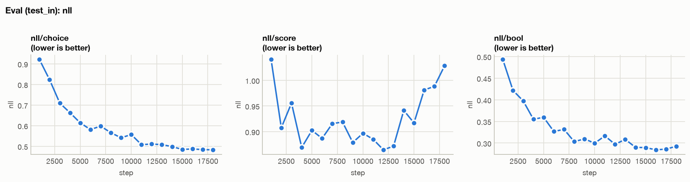

# Stage A: jev-lite on public data vs the baselines

> Run `stage_a-full-s42`, trained and evaluated on 2026-10-10 (todo Phase 6, "Stage A — evaluation").
> The first trained jev-lite model, compared with the zero-shot baselines of `BASELINES.md` on the
> same 47,557 test records. Offline public-data numbers only: they do **not** answer H0 (jev-lite vs the
> production LLM judge), which needs the human-labelled judge test set of Phase 11.

> **Revised 2026-10-11 after a review of the evaluation** (todo Phase 6, "Stage A — review of the
> evaluation"). The first version compared the models on test sets that had also served the mid-run
> eval, mixed new sources with new templates under `test_ood`, kept test records whose passage was
> trained on, and used unpaired intervals. Section 2a gives the corrected numbers; the sections below
> it keep the first-version numbers (all 47,557 records) where they are still useful and say where a
> conclusion changed.

**In short (revised).**

- **On sources and templates it was trained on, jev-lite is far ahead** of both zero-shot baselines, with paired tests on clean records (section 2a): Bool +12, Choice +21, Score +31 points over the best baseline on `test_in`; the same on held-out templates (`test_ood_template`).
- **On genuinely new sources the lead is much smaller and not uniform** (`test_ood_source`, 11,883 records): Bool 0.603 vs 0.542, Choice 0.635 vs 0.585 overall, but per source **two significant losses to NLI** (ContractNLI Bool −4.8, FaithEval counterfactual −6.1), ties on BANKING77, MultiNLI-mismatched Bool and MMLU, and wins on MultiNLI-mismatched Choice and ContractNLI Choice (borderline). Against Laya: no losses.
- **The refusal / answerability proxy fails on a new benchmark:** FaithEval-unanswerable (the answer was removed from the context) 0.490; the model says "answerable" for half of them (NLI 0.373, Laya 0.457). Answerability on trained sources (0.91) does not transfer.
- **Calibration does not transfer to new sources:** Bool ECE 0.031 on `test_in`, 0.295 on `test_ood_source`; ContractNLI 0.199 (NLI 0.107), Choice on new sources 0.114 (NLI 0.045).
- **ContractNLI is a threshold shift, not truncation** (3% of records are truncated); the class balance of the NLI training sources explains about a quarter of the shift (section 3.2).
- Retracted from the first version: "Score overfits in epoch 2" (116 / 81 noisy records, not confirmed), "every step clipped" as a problem (not for Adam), and the reading of the nonsense probe (section 6, re-run on the same items for all models).

## 1. Setup

**Model.** `answerdotai/ModernBERT-large` (395M), raw, full fine-tuning; packed encoding with one `[MASK]` marker per candidate, a shared 1024 → 256 trunk and three heads (todo 2.4–2.5). No temperatures: `log_T` stays at 0 until Phase 7.

**Data.** Mix `stage_a` (`data/mix/stage_a/mix_report.md`): 27 public datasets, 300k training records per epoch (Bool 50%, Choice 20%, Score 30%), max length 512, Choice options shuffled per epoch. Test sets: `test_in` 22,189 and `test_ood` 25,368 records, the same files as in `BASELINES.md`. `test_ood` holds the sources never trained on (ContractNLI, BANKING77, MultiNLI mismatched genres) and the held-out question templates.

**Recipe** (`configs/base.yaml` + `configs/cuda.yaml`, commit `e747da8`: the training code of `3554a4b` plus the baseline charts):

| | |
|---|---|
| Hardware | Kaggle 2×T4, DDP, fp16 AMP + GradScaler, `sdpa`, gradient checkpointing |
| Optimiser | 8-bit AdamW, lr 3e-5, warmup 6%, linear decay, weight decay 0.01, clip 1.0 |
| Batch | 16 per GPU, effective 32, length-grouped |
| Length | 2 epochs = 18,750 steps |
| Time | 566 min of training (1.8 s/step incl. evals) + 14 min of final predictions; one Kaggle session |
| Loss | CE (Choice), CE + 0.5·EMD² (Score), BCE + 0.1·Brier (Bool); weights 1 / 1 / 1 |

Eval every 1,000 steps on a fixed 2,000-record subset per split; final predictions on all test records.

**How to read the comparison.** The baselines are zero-shot; jev-lite was trained on the train splits of the same sources. `test_in` is therefore in-distribution for jev-lite only. The fair claims rest on `test_ood` and on the faithfulness sources it was not tuned on, ContractNLI and HoVer's held-out templates. Neither side has fitted temperatures.

## 2a. Revised evaluation (2026-10-11)

**What changed in the method** (code: `jevlite/data/overlap.py`, `scripts/clean_eval.py`, `jevlite/paired.py`, `scripts/compare_paired.py`):

- **Clean test sets** (`data/mix/stage_a/clean/`, `overlap_report.md`): records whose passage occurs in the training data of `stage_a` or `stage_a_nosa` are dropped (passage = list item / whole string, exact or first 200 characters; ~4.5% overall, BoolQ 27–30%, HoVer ~28%, HelpSteer3 53–60%, NQ 12–14%), and so are the 2 × 2,000 records of the mid-run eval subset, which took part in decisions.
- **`test_ood` split in two:** `test_ood_source` = a (source, domain) never trained on — ContractNLI, BANKING77, the five MultiNLI mismatched genres, and two eval-only sources added on 2026-10-11, **FaithEval** (unanswerable: Bool, all negative; counterfactual: Choice) and **MMLU**; `test_ood_template` = held-out templates on trained sources. LLM-AggreFact waits for HF access.
- **Paired tests** on the same records: Δ accuracy with a paired bootstrap CI and McNemar's exact test, Holm-corrected within each table; "win" / "loss" only when both say so.
- From the next run on, the mid-run eval uses a separate `dev` split (the unused remainder of the `test_in` pools), never the tests.

**Clean numbers, NLI / Laya / jev-lite** (48,457 records):

| | `test_in` (19,272) | `test_ood_template` (17,302) | `test_ood_source` (11,883) |
|---|---|---|---|
| Bool accuracy | 0.763 / 0.723 / **0.882** | 0.569 / 0.770 / **0.902** | 0.542 / 0.519 / **0.603** |
| Bool ECE | 0.161 / 0.076 / **0.031** | 0.314 / 0.051 / **0.026** | 0.411 / 0.367 / **0.295** |
| Choice accuracy | 0.595 / 0.596 / **0.803** | 0.617 / 0.622 / **0.794** | 0.558 / 0.585 / **0.635** |
| Choice ECE | 0.072 / 0.125 / **0.040** | 0.056 / 0.087 / **0.052** | **0.045** / 0.046 / 0.114 |
| Score accuracy | 0.242 / 0.309 / **0.620** | 0.234 / 0.315 / **0.591** | — |

**Paired, jev-lite vs the best baseline per cell** (`data/runs/stage_a-full-s42/paired/`):

| Cell | n | jev-lite | best baseline | Δ [95% CI] | Verdict |
|---|---|---|---|---|---|
| `test_in` Bool / Choice / Score | 8,902 / 9,473 / 897 | 0.882 / 0.803 / 0.620 | 0.763 / 0.596 / 0.309 | +12.0 / +20.7 / +31.1 | win |
| `test_ood_template` Bool / Choice / Score | 4,445 / 11,925 / 932 | 0.902 / 0.794 / 0.591 | 0.770 / 0.622 / 0.315 | +13.3 / +17.3 / +27.6 | win |
| `test_ood_source` Bool / Choice | 3,836 / 8,047 | 0.603 / 0.635 | 0.542 / 0.585 | +6.1 / +5.0 | win |
| ContractNLI Bool | 976 | 0.768 | NLI 0.817 | −4.8 [−7.8, −1.6] | **loss** |
| ContractNLI Choice | 953 | 0.605 | Laya 0.554 | +5.1 [+0.3, +9.9] | tie (p_Holm 0.19) |
| BANKING77 | 2,755 | 0.856 | Laya 0.846 | +1.1 [−0.2, +2.4] | tie |
| MultiNLI mismatched Bool | 370 | 0.930 | NLI 0.954 | −2.4 [−4.9, 0.0] | tie |
| MultiNLI mismatched Choice | 347 | 0.876 | Laya 0.634 | +24.2 | win |
| FaithEval unanswerable (Bool) | 2,490 | 0.490 | Laya 0.457 | +3.3 [+1.0, +5.6] | tie (p_Holm 0.06) |
| FaithEval counterfactual (Choice) | 981 | 0.736 | NLI 0.797 | −6.1 [−9.4, −3.0] | **loss** |
| MMLU | 2,996 | 0.379 | NLI 0.382 | −0.3 [−2.4, +1.9] | tie |

Over all 61 source × split cells: vs NLI 43 wins, 16 ties, 2 losses; vs Laya 52 wins, 9 ties, 0 losses.

**Reading.** The large margins are on data the model was trained on (sources and, for templates, the same sources). On new data the useful signal is ranking (ContractNLI AUC) rather than accuracy at 0.5, and calibration breaks. The judge will meet new domains first, so these are the numbers that matter for it; Stage B (domain variety) and Phase 7 (a calibrator that can move the bias) target exactly this.

## 2. Headline numbers (first version: all 47,557 records, before cleaning)

Point estimates over all of `test_in` + `test_ood`; 95% bootstrap intervals (1,000 resamples) in `data/runs/stage_a-full-s42/report/`.



*Accuracy per source and primitive, sorted by "jev-lite − best baseline". jev-lite beats both baselines on every row above the dashed line; below it are ContractNLI, WANLI, MultiNLI and SNLI as Bool, where NLI stays ahead.* [Interactive version](docs/stage_a/figures/accuracy_by_source.html)

| Primitive | Metric | NLI | Laya | jev-lite | jev-lite 95% CI |
|---|---|---|---|---|---|
| Bool | accuracy | 0.712 | 0.730 | **0.883** | 0.878–0.888 |
| | κ | 0.425 | 0.456 | **0.766** | 0.756–0.776 |
| | NLL | 0.907 | 0.549 | **0.285** | |
| | ECE | 0.202 | 0.070 | **0.033** | 0.030–0.038 |
| | AURC | 0.158 | 0.147 | **0.030** | |
| | selective accuracy at 80% | 0.763 | 0.780 | **0.945** | |
| Choice | accuracy | 0.611 | 0.635 | **0.800** | 0.795–0.804 |
| | κ | 0.531 | 0.558 | **0.758** | 0.752–0.764 |
| | NLL | 1.053 | 1.525 | **0.542** | |
| | ECE | 0.057 | 0.089 | **0.052** | 0.048–0.057 |
| | AURC | 0.244 | 0.222 | **0.063** | |
| Score | accuracy | 0.241 | 0.314 | **0.599** | 0.579–0.619 |
| | weighted κ | 0.294 | 0.366 | **0.678** | 0.643–0.710 |
| | Spearman | 0.005 | 0.222 | **0.666** | |
| | MAE (levels) | 1.205 | 1.027 | **0.591** | |
| | ECE | 0.115 | 0.187 | **0.104** | 0.089–0.123 |

**By split.** jev-lite is at the same level on `test_ood` as on `test_in`, while the baselines' numbers move with the source mix (`BASELINES.md` section 9):

| | `test_in`: NLI / Laya / jev-lite | `test_ood`: NLI / Laya / jev-lite |
|---|---|---|
| Bool | 0.759 / 0.722 / **0.884** | 0.638 / 0.741 / **0.882** |
| Choice | 0.595 / 0.600 / **0.805** | 0.621 / 0.656 / **0.796** |
| Score | 0.245 / 0.312 / **0.618** | 0.238 / 0.317 / **0.581** |

**Without ClapNQ** (section 8): Bool 0.879 overall, 0.876 on `test_ood`; answerability 0.907 (NLI 0.669, Laya 0.746).

## 3. Where it wins and where it does not

### 3.1 Claim vs text (faithfulness)



*Bool accuracy per claim-vs-text group. jev-lite leads overall and on FEVER and HoVer; on held-out ContractNLI NLI stays ahead.* [Interactive version](docs/stage_a/figures/faithfulness.html)

| Bool sources | n | NLI | Laya | jev-lite |
|---|---|---|---|---|
| Claim vs text, all (MultiNLI, SNLI, WANLI, VitaminC, ContractNLI, FEVER, HoVer) | 5,758 | 0.853 | 0.682 | **0.877** |
| ContractNLI (held out, `test_ood`) | 1,054 | **0.819** | 0.591 | 0.775 |
| FEVER | 656 | 0.936 | 0.806 | **0.959** |
| HoVer, all | 1,000 | 0.707 | 0.568 | **0.866** |
| HoVer, 2 / 3 / 4 hops | 293 / 458 / 249 | 0.754 / 0.699 / 0.667 | 0.608 / 0.541 / 0.570 | **0.850 / 0.889 / 0.843** |
| VitaminC | 658 | 0.816 | 0.799 | **0.913** |
| MultiNLI / SNLI / WANLI | 1,053 / 674 / 663 | **0.950 / 0.947 / 0.833** | 0.718 / 0.761 / 0.624 | 0.925 / 0.941 / 0.793 |

- **HoVer is solved much better.** It is the closest public proxy for the judge's full-context pass, since every claim needs 2–4 abstracts. jev-lite does not lose accuracy with the number of hops, and it catches "not supported" in 84% of cases (NLI 46%, Laya 25%).
- **ContractNLI is the one faithfulness bar not met** (section 3.2).
- On MultiNLI, SNLI and WANLI, NLI keeps a small lead of 0.6–4 points. All three are in NLI's own training data (`BASELINES.md` section 9), so this is the expected order.

### 3.2 ContractNLI: good ranking, wrong threshold

| ContractNLI, Bool | NLI | Laya | jev-lite |
|---|---|---|---|
| ROC AUC | 0.884 | 0.650 | **0.931** |
| accuracy at 0.5 | **0.819** | 0.591 | 0.775 |
| accuracy at the best threshold (chosen on the test set: an upper bound) | 0.824 | 0.618 | **0.868** |
| mean P(supported) (45% of records are positive) | 0.42 | 0.54 | **0.26** |
| recall: supported / not supported | 0.75 / 0.87 | 0.69 / 0.51 | **0.52** / 0.98 |

jev-lite orders ContractNLI claims better than NLI, but its probabilities are shifted down: on legal NDAs, a domain and a document style it has not seen, it calls half of the supported claims unsupported. For the judge this is the failure mode to expect on a new customer domain: **too strict, not too lenient**. Temperature scaling (Phase 7) cannot fix it, since a temperature does not move the 0.5 point of a Bool.

**Cause, checked (2026-10-11).** *Truncation is excluded:* state + claim p50 186, p90 350 tokens; 2.9% (31 records) exceed 512, and they are worse (0.645) but too few. *Class balance explains part of it:* ContractNLI goes through template `nli/claim`, whose training positives are 33–37% on the NLI sources (MultiNLI, SNLI, WANLI) and 50–61% on fact-checking sources; ContractNLI has 45%. Shifting the logit by the prior difference (0.34 → 0.45, +0.46) lifts accuracy 0.775 → 0.797; a shift that matches the true positive rate (+1.99, an oracle that uses test labels) → 0.860. So about a quarter of the shift is the training prior, the rest the domain. ECE on ContractNLI is 0.199 (NLI 0.107), hidden by the pooled 0.033. What can help:

- more domain variety in the training data (Phase 4: synthetic data over 18 domains, 4 held out);
- a bias term in the answer-level calibrator fitted on in-domain labels (Phase 11 already plans one on human labels);
- watching the per-domain base rate in production;
- label-shift estimation without labels on a new domain (EM on predicted probabilities), to try in Phase 7;
- balancing positive rates per template in the Stage B mix.

### 3.3 Answerability and the negative class



*Recall of each label. The baselines' weak side was "not supported / unanswerable"; jev-lite's weak side is "supported" on ContractNLI. The ClapNQ row is a shortcut (section 8).* [Interactive version](docs/stage_a/figures/recall_by_label.html)

| Recall: positive / negative | NLI | Laya | jev-lite |
|---|---|---|---|
| FEVER | 0.97 / 0.92 | 0.94 / 0.74 | **0.97 / 0.96** |
| HoVer | 0.94 / 0.46 | 0.87 / 0.25 | 0.90 / **0.84** |
| ContractNLI | **0.75** / 0.87 | 0.69 / 0.51 | 0.52 / **0.98** |
| Natural Questions | 0.60 / 0.77 | 0.87 / 0.53 | **0.91 / 0.89** |
| SQuAD 2.0 | 0.68 / 0.71 | 0.82 / 0.47 | **0.93 / 0.83** |

- Answerability, the closest public proxy for judging refusals: 0.907 without ClapNQ (Laya 0.746, NLI 0.669). Both sides of NQ are now near 0.9; for both baselines one side had been near chance.
- QNLI 0.930 (Laya 0.801), BoolQ 0.831 (0.777), PAWS 0.936 (0.890).

### 3.4 Other Bool tasks and Choice

| Source | NLI | Laya | jev-lite |
|---|---|---|---|
| TabFact (claim vs table) | 0.583 | 0.513 | **0.706** |
| CLINC150 / BANKING77 (held out) | 0.736 / 0.670 | 0.935 / 0.843 | **0.972 / 0.853** |
| GoEmotions / MASSIVE / DBpedia-14 | 0.433 / 0.747 / 0.905 | 0.643 / 0.755 / 0.916 | **0.792 / 0.961 / 0.994** |
| ARC / OpenBookQA / CommonsenseQA | 0.604 / 0.548 / 0.554 | 0.433 / 0.338 / 0.444 | **0.627 / 0.608 / 0.694** |
| Cosmos QA / Social IQa | 0.463 / 0.541 | 0.273 / 0.467 | **0.769 / 0.705** |
| 3-way NLI as Choice (VitaminC, SNLI, MultiNLI) | 0.54–0.58 | 0.65–0.71 | **0.86–0.87** |
| FEVER as Choice | 0.693 | 0.699 | **0.906** |
| ContractNLI as Choice (held out) | 0.554 | 0.553 | **0.603** |
| Summary preference (K = 2) | 0.555 | 0.520 | **0.646** |

- Tables are no longer at chance, but 0.706 is far from usable for a judge. Table data in Phase 4 stays required.
- On BANKING77, the held-out intent set, the lead over Laya is only 1 point: Laya was trained on intents.
- MCQA is the weakest Choice family on knowledge-heavy sets (ARC, OpenBookQA, 0.61–0.63). That is expected from a 395M encoder and does not matter for the judge.

### 3.5 Score



*Exact-level accuracy per criterion (HelpSteer2 attributes and HelpSteer3 preference).* [Interactive version](docs/stage_a/figures/score_by_criterion.html)

| Criterion | NLI | Laya | jev-lite |
|---|---|---|---|
| coherence | 0.083 | 0.216 | **0.727** |
| verbosity | 0.358 | 0.436 | **0.709** |
| complexity | 0.247 | 0.372 | **0.623** |
| correctness | 0.187 | 0.264 | **0.523** |
| helpfulness | 0.252 | 0.283 | **0.475** |
| preference (HelpSteer3) | 0.373 | 0.309 | **0.500** |

Spearman 0.666 and MAE 0.59 levels, against 0.22 and 1.03 for Laya. The criteria the judge's relevance rubric resembles most, correctness and helpfulness, are the weakest (0.48–0.52). This is the place where our own labels (Phase 11) should help most.

## 4. Calibration



*Reliability per primitive. jev-lite's Bool curve is close to the diagonal (slightly above it at low probabilities, i.e. a little underconfident there); NLI's is flat in the middle. On Score jev-lite is the only model whose curve rises with confidence.* [Interactive version](docs/stage_a/figures/reliability.html)



*Choice: accuracy (filled) vs mean top probability (hollow) per K bucket. jev-lite is mildly overconfident in every bucket, with no jump at bucket edges.* [Interactive version](docs/stage_a/figures/calibration_by_k.html)

| K | n | jev-lite accuracy | mean confidence | gap | Laya gap |
|---|---|---|---|---|---|
| 2 | 2,000 | 0.646 | 0.734 | +0.09 | +0.33 |
| 3–5 | 14,978 | 0.784 | 0.846 | +0.06 | +0.01 |
| 6–10 | 6,435 | 0.829 | 0.865 | +0.04 | +0.08 |
| 11+ | 4,566 | 0.876 | 0.904 | +0.03 | +0.22 |

- Bool ECE 0.033 and Choice ECE 0.052 before any temperature. Both are below the best baseline per primitive, which was the calibration bar of `BASELINES.md` section 8.
- The overconfidence is small and smooth in K. A single temperature, or the smooth T(K) of todo 2.7, should remove most of it in Phase 7.
- Score ECE is 0.104 (MCE 0.23), the weakest; the Score overfitting of section 7 is the likely cause.

## 5. Selective prediction (the cascade view)



*Error rate of the answered share as coverage grows. jev-lite's error stays near zero for the most confident 40–60% and rises only after that; the baselines' curves rise almost linearly from the start, i.e. their confidence barely separates right from wrong answers.* [Interactive version](docs/stage_a/figures/risk_coverage.html)

| Accuracy on the most confident share | 80%: NLI / Laya / jev-lite | 90%: jev-lite |
|---|---|---|
| Bool | 0.763 / 0.780 / **0.945** | 0.918 |
| Choice | 0.658 / 0.687 / **0.869** | 0.832 |
| Score | 0.233 / 0.336 / **0.675** | 0.633 |

Escalating the 20% least confident Bool answers lifts accuracy from 0.883 to 0.945; AURC falls from 0.147 (Laya) to 0.030. The cascade of todo 2.12 becomes viable on this signal, with the caveat of section 6.3.

## 6. Black-box probes (revised 2026-10-11: same 200 items for all three models)

Re-run on 2026-10-11 for NLI, Laya and jev-lite with the same data (clean `test_in`), seed and items: `probe_blackbox.py --n-items 200 --shortcuts 200`, results in `data/probes_2026-10-11/`. The first version compared jev-lite with baseline probes on an older sample; the numbers below replace them (the charts in `docs/stage_a/figures/` still show the first version).

### 6.1 Order sensitivity and IIA

| | NLI | Laya | jev-lite |
|---|---|---|---|
| mean spread of an option's probability over 8 permutations | 0.000 | 0.085 | **0.037** |
| argmax changes under a permutation | 0% | 12.4% | **2.8%** |
| IIA: mean change of log-ratios, added option from **any** source | 0.000 | 0.97 | **0.31** |
| IIA: same, added option from the **same source** (near-miss, 173 items) | 0.000 | 0.79 | **0.26** |
| mass taken by the added (wrong) option: any / same source | 0.103 / 0.104 | 0.108 / 0.098 | **0.020 / 0.040** |

Option shuffling in training worked: the answer flips in 2.8% of permutations (Laya 12%). A near-miss option from the same source takes twice the mass of an unrelated one (4% vs 2%), still well below what the order-free NLI model gives it (10%); IIA holds about as well with near-misses as with unrelated options.

### 6.2 Confidence on nonsense inputs, by primitive and predicted label

| State → mean confidence | NLI | Laya | jev-lite |
|---|---|---|---|
| all items: real / shuffled words / random characters | 0.51 / 0.42 / 0.35 | 0.43 / 0.32 / 0.54 | 0.70 / 0.51 / 0.62 |
| **Bool** (90): real / random characters | 0.73 / 0.75 | 0.37 / 0.81 | 0.72 / 0.89 |
| Bool, random characters: share answered "no" | 98% | 47% | **99%** |
| Bool, shuffled words: share answered "yes" (confidence) | 29% (0.47) | 53% (0.28) | 30% (0.33) |
| **Choice** (102): real / shuffled words / random characters | 0.35 / 0.27 / 0.03 | 0.50 / 0.37 / 0.33 | **0.68 / 0.58 / 0.39** |
| Score (8 items only): real / random characters | 0.07 / 0.01 | 0.32 / 0.13 | 0.54 / 0.53 |

### 6.3 What it means (revised)

The first version read the pooled numbers as "confidence does not notice garbage". Split by primitive, that reading does not hold:

- **Bool:** on random characters jev-lite answers "no" for 89 of 90 claims with confidence 0.90. "The text does not support the claim" is the **right** answer for garbage, so high confidence there is correct, and it is what pushed the pooled number up.
- **Choice:** confidence does drop, 0.68 → 0.39 on random characters, but only to 0.58 on shuffled words: a bag of the right words still looks like evidence.
- **Bool on shuffled words:** 30% "yes" (NLI 29%), with low confidence (0.33). Word order is partly ignored, as by the NLI model.
- **Score:** 8 items, no conclusion.

The entropy heuristic is therefore usable for garbage on Choice, weak on shuffled text, and silent on Score. The learned confidence head (todo 2.8) is still worth having for the cascade, but the argument for it is the weak drop on shuffled words and the poor calibration on new sources (section 2a), not "no reaction to garbage".

### 6.4 Shortcuts on Bool: hypothesis-only and passage swap

Per source, 200 Bool records: the claim / question with an empty state ("(no text)") and with the state of another record of the same source. Without evidence, "yes" should disappear.

| Share answered "yes": real / empty state / swapped state | NLI | Laya | jev-lite |
|---|---|---|---|
| HoVer | 0.70 / 0.00 / 0.26 | 0.81 / 0.30 / 0.08 | 0.58 / 0.00 / **0.00** |
| FEVER, VitaminC, MultiNLI, SNLI, WANLI, QNLI | ≤ 0.10 on swap | ≤ 0.35 empty | **0.00–0.03** both |
| BoolQ / NQ / SQuAD 2.0 | 0.07 / 0.06 / 0.03 swap | 0.07 / 0.04 / 0.03 | 0.03 / 0.01 / 0.01 |
| **TabFact** | 0.39 / 0.00 / 0.00 | 0.66 / 0.12 / 0.15 | 0.64 / 0.00 / **0.54** |
| **ClapNQ** | 0.66 / 0.00 / 0.33 | 0.68 / 0.01 / 0.05 | 0.48 / 0.00 / **0.54** |

- **No claim-only shortcut anywhere:** with an empty state jev-lite answers "no" for every source, so hypothesis-only accuracy equals the negative rate (never above the majority class). HoVer, the first suspect, passes both tests: its lead over NLI is not a shortcut.
- **TabFact is a passage-type shortcut:** with a different table jev-lite still says "yes" 54% of the time (real 64%); NLI says 0%. The model checks that *a* table is there and judges the claim's plausibility, not the claim against *this* table. A part of its 0.71 on TabFact is not table reading. Same pattern as ClapNQ (section 8), confirmed here (swap 0.54).
- PAWS is left out: both sentences are in the state and the prompt is the same for every record, so neither test applies.
- For Stage B and Phase 8: run the swap test on every source, including tables and synthetic data (todo, 2×2 passage-swap test); table data in Phase 4 must have positives and negatives on the same table (TabFact has both labels per table, so the shortcut is learned from the claims' wording; harder table negatives are needed).

## 7. Training dynamics



*Eval NLL on the fixed 2,000-record `test_in` subset. Bool and Choice keep improving to the end; Score bottoms out around step 12k and then rises.* Also in `docs/stage_a/training/`: accuracy and ECE per split, train loss, accuracy, learning rate and grad norm.

- **Bool and Choice** improve through both epochs. Their gains in the second half are small: Bool `test_in` accuracy 0.868 at step 9k (the epoch boundary), 0.882–0.886 from 14k on.
- **Score overfitting: not confirmed** (revised 2026-10-11). The curve below rests on 116 (`test_in`) and 81 (`test_ood`) Score records of the 2,000-record eval subset, too few to read a rise of 0.16 in NLL; the final Score numbers on all clean records (0.62 / 0.59) do not show a collapse. To be checked on the full `dev` Score set in the next run. The first reading was: eval NLL/score drops to 0.87 at step 12k and rises to 1.03 by step 18k, while Bool and Choice are still improving. The suspected cause:
  - Score is 30% of the mix, 90k records per epoch from a pool of 59k: 1.52× per epoch, ~3× per run.
  - HelpSteer2 rates every response on five attributes, so a response text comes back ~15 times over the run.
  - **Decision (2026-10-10, now provisional):** keep the 30% share. From Stage B on, every Score record is seen at most once per run (`run_repeat: {score: 1.0}`), and Score's share of the gradient is kept by the loss weights (score 1.41, choice 0.93, bool 0.98 on the Stage A mix). `build_mix.py --batch-size` measures them on the length-grouped batches (todo, Stage B). The HelpSteer2 ×5 text repeats stay as they are (todo Q5).
- **Train vs eval:** in the last 2,750 steps train accuracy is Bool 0.911 / Choice 0.823, eval 0.882–0.886 / 0.824 on `test_in`. That is a small gap, except for Score.
- **Grad norm 10–14 for the whole run, against a clip of 1.0:** every update was clipped. *Revised 2026-10-11:* the logged norm is the true one (`scaler.unscale_` runs before `clip_grad_norm_`, `train.py`), but this is **not a problem for Adam**: dividing every gradient by a similar factor barely changes Adam's update, which is close to scale-invariant; the clip only re-weights steps inside the moment estimates when the norm varies. The first version's "the effective step is set by the clip, not by the learning rate" was wrong.
- No time-outs: 566 minutes against the 690-minute limit, one session, no resume needed.

## 8. A data issue found: ClapNQ

jev-lite scores **1.000 on all 600 ClapNQ test records**, against 0.907 on Natural Questions. A passage-swap test shows the label follows the passage, not the question:

| ClapNQ, mean P(answerable) | passage of an answerable record | passage of an unanswerable record |
|---|---|---|
| answerable question | 0.978 | 0.002 |
| unanswerable question | 0.948 | 0.002 |

- ClapNQ builds its two classes from different passage pools, so no passage occurs with both labels. The model learned which pool a passage comes from.
- NQ and SQuAD 2.0 pass the same test: with any mismatched passage, P(answerable) is 0.01–0.04.
- Kept as is in Stage A, since ClapNQ is 0.8% of the training data. It is excluded from the headline answerability number and fixed for Stage B.
- Full account, checks and fix: `DATASETS.md` section 5.1.

## 9. Against the bars of `BASELINES.md` section 8

*First-version table, unpaired, all records. The ✓ / ✗ marks are superseded by the paired verdicts of section 2a: on new sources the ContractNLI and FaithEval-counterfactual cells are losses and several are ties.*

| Area | Bar (best baseline) | jev-lite | Met |
|---|---|---|---|
| Faithfulness, claim vs text | NLI 0.853 | 0.877 | ✓ |
| Faithfulness, held-out ContractNLI | NLI 0.819 | 0.775 (AUC 0.931 vs 0.884) | **✗** (ranking ✓, threshold ✗) |
| Faithfulness, multi-hop HoVer | NLI 0.707 | 0.866 | ✓ |
| Answerability / refusals (without ClapNQ) | Laya 0.746 | 0.907 | ✓ |
| Unanswerable side, NQ | NLI 0.774 | 0.891 | ✓ |
| Choice, classification (CLINC150 / BANKING77) | Laya 0.935 / 0.843 | 0.972 / 0.853 | ✓ |
| Choice, MCQA | NLI 0.46–0.60 | 0.61–0.77 | ✓ |
| Score (rubrics) | Laya accuracy 0.31, Spearman 0.22 | 0.60, 0.67 | ✓ |
| Calibration, ECE per primitive | 0.057 Choice (NLI), 0.115 Score (NLI), 0.070 Bool (Laya) | 0.052 / 0.104 / 0.033 | ✓ |

The design consequences of `BASELINES.md` section 8, checked:

1. **Smooth T(K):** no K-bucket jumps, mild overconfidence everywhere (section 4); fit T in Phase 7.
2. **Option shuffling:** works, with 3.9% order flips (section 6.1).
3. **Learned confidence:** still needed (section 6.3).
4. **Tables:** better but weak, 0.706 (section 3.4); table data in Phase 4.
5. **Claims across several chunks:** HoVer 0.866, and "not supported" is now caught (section 3.1).

## 10. What it means for Stage B

1. **Domain shift is the main risk for the judge.** On ContractNLI the model is too strict. Stage B's synthetic data needs domain variety with held-out domains (Phase 4), and Phase 7/11 need a calibrator that can move the threshold, not only the temperature.
2. **Data hygiene:** positives and negatives must come from the same passage pool (ClapNQ, section 8). Run the passage-swap test on every answerability source, synthetic ones included (todo Phase 4 and Phase 8).
3. **Score recipe:** at most one pass per record per run, with compensating loss weights (section 7).
4. **Confidence head (v2)** for the cascade (section 6.3, revised: weak drop on shuffled text, poor calibration on new sources).
7. **Refusals on new data:** FaithEval-unanswerable 0.49 (section 2a). Stage B needs unanswerable cases built by removing the answer from a passage that otherwise stays on topic (as FaithEval does), not only SQuAD 2.0 / NQ style negatives.
8. **Tables:** TabFact is partly a shortcut (section 6.4); Phase 4 table data needs hard negatives on the same table.
5. **Starting point:** Stage B starts from this checkpoint (or from `stage_a_nosa`, if it is trained and preferred; todo Phase 6).
6. **Quota:** the Kaggle GPU quota is the constraint. Stage B with the Score cap is ~20% shorter per epoch, and dropping gradient checkpointing may save another 25–30% if memory allows (todo, status).

## 11. Caveats

- **In-distribution training.** jev-lite saw the train splits of 25 of the 27 test sources; the baselines saw none (NLI saw MultiNLI, FEVER and WANLI). Per-source `test_in` numbers favour jev-lite. The fair test is `test_ood_source` (section 2a), where the lead shrinks to 5–6 points and is not uniform.
- **No trained-vs-trained control.** The baselines are zero-shot, so the comparison does not say what the packed architecture adds over fine-tuning any encoder on the same mix. Planned: pair mode (`encoding.mode: pair`) on the same mix, after `stage_a_nosa` (todo Q4).
- **Passage overlap with train** (revised): with per-passage keys HoVer is ~28%, not 6% (shared Wikipedia intros); headline numbers are now on the clean sets (section 2a).
- **One run, one seed.** Bootstrap intervals cover test sampling, not training variance; differences of a few points between runs need a second seed.
- **No temperatures and no learned confidence** yet (Phases 7 and 2.8). The calibration numbers are raw.
- **Probes:** 200 items (Score: 8), one seed; the charts in `docs/stage_a/figures/` still show the first-version probes.
- **Public proxies only.** Not the judge task itself: LLM-AggreFact is converted but gated (HF access pending), and our own data arrives in Phase 11.
- **The intermediate eval curves** use a fixed 2,000-record subset per split (Score: 116 and 81 records), so Score points are noisy, and they were drawn from the test sets (removed from the clean sets).
- **Not measured yet:** latency, the share of truncated contexts and accuracy by length, and the annotator-agreement ceiling for Score (todo, Stage A review).

## 12. Files and reproduction

Run files (git-ignored), `data/runs/stage_a-full-s42/`: `final/` (encoder + heads, loadable with `checkpoint.load_final`), `preds.jsonl`, `report/report.{md,json}`, `probes.json`, `metrics.jsonl`, `run.log`, `config.yaml`. The same files are in the private Hub repo `Nefelim584/jevlite-runs`, folder `stage_a-full-s42/`, with the last two checkpoints.

Charts and reports (tracked): `docs/stage_a/figures/` (the charts above, PNG + interactive HTML), `docs/stage_a/compare/report.md` (side-by-side tables per source, domain, criterion and split), `docs/stage_a/training/report.md` (learning curves).

```
RUN=stage_a-full-s42; R=data/runs/$RUN; T="data/mix/stage_a/test_in.jsonl data/mix/stage_a/test_ood.jsonl"
# training: notebooks/cuda/10_train_stage_a_public.ipynb on Kaggle 2×T4 (RUN, MIX = "stage_a", MAX_MINUTES = 690)
hf download Nefelim584/jevlite-runs --include "$RUN/final/*" --include "$RUN/preds.jsonl" --include "$RUN/metrics.jsonl" \
  --include "$RUN/run.log" --include "$RUN/config.yaml" --local-dir data/runs
uv run python scripts/eval.py --data $T --pred $R/preds.jsonl --out $R/report --bootstrap 1000
HF_HUB_OFFLINE=1 uv run python scripts/probe_blackbox.py --baseline jevlite --model $R/final \
  --data data/mix/stage_a/test_in.jsonl --out $R/probes.json --n-items 200
uv run --extra reports python scripts/make_report.py training --run $RUN=$R --out docs/stage_a/training
uv run --extra reports python scripts/make_report.py compare --out docs/stage_a/compare \
  --run nli=data/baselines/reports/nli/report.json --run laya=data/baselines/reports/laya/report.json --run jevlite=$R/report/report.json
uv run --extra reports python scripts/make_baselines_figures.py --out docs/stage_a \
  --model jevlite $R/preds.jsonl $R/report/report.json $R/probes.json
```

Revised evaluation (2026-10-11):

```
C=data/mix/stage_a/clean; R=data/runs/stage_a-full-s42
uv run python scripts/clean_eval.py --train data/mix/stage_a/train.e*.jsonl data/mix/stage_a_nosa/train.e*.jsonl \
  --data data/mix/stage_a/test_in.jsonl data/mix/stage_a/test_ood.jsonl data/mix/stage_a/dev.jsonl \
  --drop-eval-subset test_in test_ood \
  --eval-subset-ref test_in=data/mix/stage_a/run_eval/test_in.jsonl test_ood=data/mix/stage_a/run_eval/test_ood.jsonl --out $C
# predictions for the records added to test_ood (MMLU, FaithEval), per model: predict_baseline.py ... --data data/mix/stage_a/test_ood.jsonl --resume
uv run python scripts/eval.py --data $C/test_in.jsonl $C/test_ood_source.jsonl $C/test_ood_template.jsonl --pred $R/preds.jsonl --out $R/report_clean --bootstrap 1000
uv run python scripts/compare_paired.py --data $C/test_in.jsonl $C/test_ood_source.jsonl $C/test_ood_template.jsonl \
  --model jevlite=$R/preds.jsonl --ref nli=data/baselines/preds/nli.jsonl --ref laya=data/baselines/preds/laya.jsonl --out $R/paired
HF_HUB_OFFLINE=1 uv run python scripts/probe_blackbox.py --baseline jevlite --model $R/final --data $C/test_in.jsonl \
  --out data/probes_2026-10-11/jevlite.json --n-items 200 --shortcuts 200   # the same for --baseline nli / laya
```

The ContractNLI AUC and threshold table, the HoVer hop split, the per-label recalls, the passage-overlap check and the ClapNQ passage-swap test were computed ad hoc from `preds.jsonl`, the test files and the final model. They are not part of `eval.py`'s output; the swap test is planned for Phase 8.
