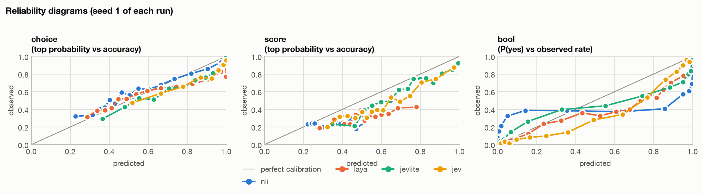
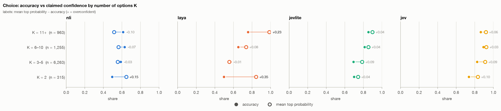
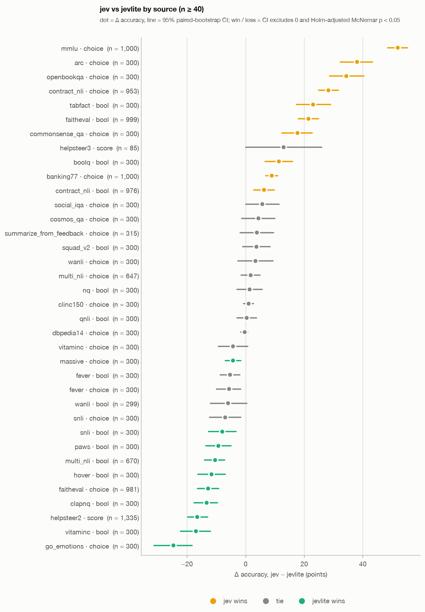
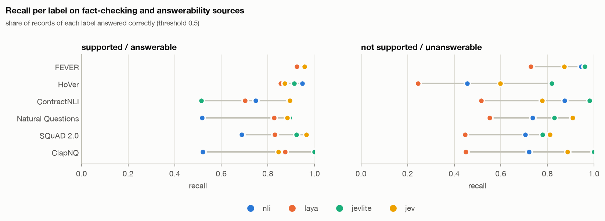
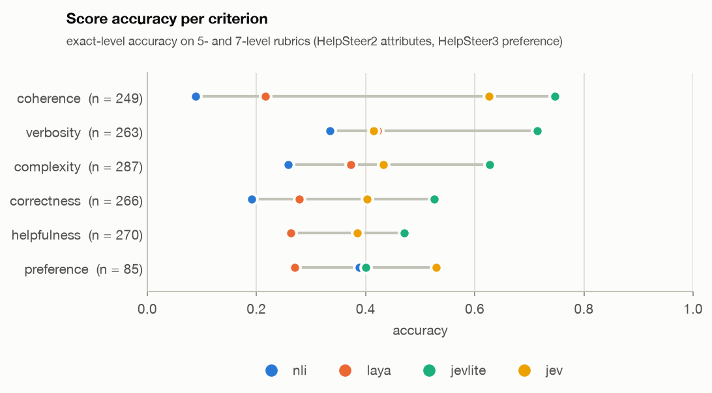
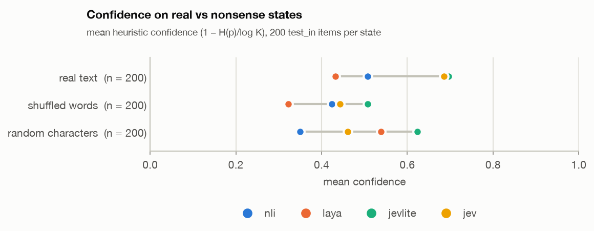
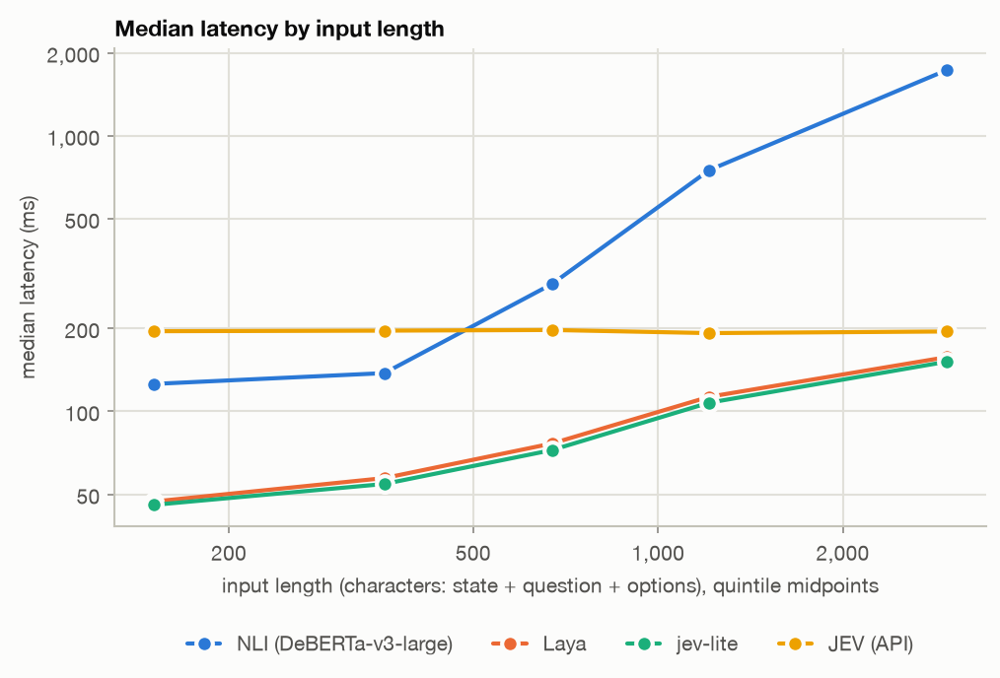

# Stage A vs JEV (API)

> JEV (TypeSafe AI, `jev-latest` → **`jev-1.13.0`** for every call) against jev-lite `stage_a-full-s42`,
> NLI and Laya on the clean Stage A test sets (`data/mix/stage_a/clean/`, `STAGE_A.md` section 2a).
> Two rounds of API calls: a balanced sample of 5,600 records (700 per split × primitive), then a
> top-up to ≥ 300 records per source and up to 1,000 per new source (16,460 records in all), a Bool
> wording check, black-box probes and a determinism check. Offline public-data numbers only, like
> `STAGE_A.md`: they do not answer H0.

## Summary

- **JEV beats NLI and Laya everywhere** (every split and primitive, significant).
- **Against jev-lite it depends on the data:**
  - **New sources (`test_ood_source`): JEV far ahead**, Bool 0.763 vs 0.601 (+16.1), Choice 0.884 vs 0.627 (+25.7).
  - **Trained sources and held-out templates: Bool and Choice tied** on the balanced sample (−1.1 to +4.6).
  - **Score: jev-lite wins**, 0.606 vs 0.452 (−15.4), almost all HelpSteer2.
- **Per source (16,460 records), 10 wins and 10 losses for JEV.** Its wins are knowledge-heavy multiple choice (MMLU +52, ARC +38, OpenBookQA +34), new faithfulness data (FaithEval Bool +21, ContractNLI +6 / +28) and TabFact (+23). Its losses are the label sets jev-lite was trained on: NLI-style entailment (VitaminC −17, MultiNLI −10, SNLI −8, PAWS −9), multi-hop HoVer (−12), ClapNQ (−13), go_emotions (−25), HelpSteer2 (−17).
- **JEV answers part of the fact-checking claims from its own knowledge, not from the text.** With the passage removed it still gets BoolQ 78% (majority 67%), FEVER 81% (68%), HoVer 61% (51%); every other model falls to the majority rate. With an unrelated passage it says "supported" to 45% of VitaminC claims. For a faithfulness judge this is the main risk found.
- **JEV is not deterministic:** the same request twice gives probabilities up to 0.11 apart (61 of 100 records differ), and 2 of 100 answers flip.
- **Wording matters a little:** giving the Bool question explicit yes/no criteria lifts JEV's Bool accuracy from 0.831 to 0.860 (+2.9, significant) and lowers ECE from 0.103 to 0.078. All other numbers here use the plain statement, as for the other models.
- **Probes:** JEV is the least sensitive to option order of the trained models (2.1% flips vs jev-lite 2.8%, Laya 12.4%) and its confidence drops most on nonsense input, but adding an irrelevant option shifts its other probabilities more than jev-lite's (IIA log-ratio change 0.64 vs 0.31).
- **Speed:** on an M1 Pro laptop GPU, jev-lite answers in 73 ms (median, p90 152 ms) against 195 ms for a JEV API call: 2.7–4× faster on short and medium inputs, 1.3× on the longest fifth (1,500–4,400 characters). NLI takes 241 ms (p90 1.9 s).
- **Cost:** 27,800 calls, 12.2M input and 1.2M output tokens over both rounds; latency p50 196 ms.

## 1. Setup

**Round 1, balanced sample.** `scripts/predict_jev_api.py sample` (seed 0): 700 records per split × primitive, sources in proportion to the clean test set. All split-level numbers below come from it, because its cells weigh sources as the test sets do.

| Split | Bool | Choice | Score |
|---|---|---|---|
| `test_in` | 700 | 700 | 700 |
| `test_ood_source` | 700 | 700 | – |
| `test_ood_template` | 700 | 700 | 700 |

**Round 2.**

| Run | Records / calls | Input tokens | What for |
|---|---|---|---|
| Top-up (`topup`, seed 1) | 10,862 records, 2 failed (HTTP 499) | 4.94M | every trained (source, primitive) to ≥ 300 records (`test_in` + `test_ood_template` pooled), every new one to 1,000 or all; per-source numbers below use round 1 + top-up |
| Bool wording | 2 × 700 | 0.72M | the first 700 Bool records of the sample as a question / with yes–no criteria |
| Probes | 9,843 calls (+1,103 identical requests from the cache) | 3.83M | `probe_blackbox.py` checks, same items and seed as for NLI, Laya and jev-lite |
| Determinism | 100 | ~0.05M | 100 sample records sent again |

**Calls.** One record per call, `typesafe-sdk` `system_one`. Mapping as for Laya: Choice → `Choice` with the options as criteria, Score → `Score` with the levels in order, Bool → `Noul` with the record's statement as instructions (P(yes) = `noul`). The other models' predictions are the existing ones on the full test sets, restricted to the same records.

**Tests.** As in `STAGE_A.md`: paired bootstrap CI of Δ accuracy and McNemar's exact test, Holm-corrected within each table; "win" / "loss" only when both agree.

## 2. Overall (balanced sample)

Pooled over the 5,600 records of round 1, equal weight per cell. 95% bootstrap intervals in `data/jev_api/eval/`.

| | JEV | jev-lite | NLI | Laya |
|---|---|---|---|---|
| Bool accuracy | **0.836** | 0.782 | 0.600 | 0.643 |
| Bool ECE | **0.109** | 0.121 | 0.305 | 0.165 |
| Bool NLL | **0.392** | 0.549 | 1.306 | 0.649 |
| Choice accuracy | **0.856** | 0.743 | 0.591 | 0.604 |
| Choice ECE | **0.055** | 0.069 | 0.072 | 0.088 |
| Choice NLL | 0.915 | **0.682** | 1.091 | 1.603 |
| Score accuracy | 0.452 | **0.606** | 0.237 | 0.311 |
| Score MAE (expected level) | 0.793 | **0.597** | 1.066 | 0.949 |
| Score Spearman | 0.532 | **0.657** | −0.012 | 0.231 |
| Score ECE | 0.149 | **0.107** | 0.114 | 0.187 |

The charts in this section and in sections 4–5 use all 16,460 records (`data/jev_api/eval_all/`), so sources weigh more equally than in the table.


*Accuracy per source and primitive, sorted as in `STAGE_A.md` (jev-lite − best baseline; jev-lite beats both baselines above the dashed line). JEV (amber) leads on most rows; where jev-lite (green) is ahead of it, the source is one jev-lite was trained on.* [Interactive version](docs/stage_a_api/figures/accuracy_by_source.html)



*Reliability per primitive. Bool: JEV's P(yes) is too high between 0.1 and 0.7 (observed rate below the diagonal) and close to it above 0.8. Score: JEV and jev-lite both rise with confidence, JEV a little below.* [Interactive version](docs/stage_a_api/figures/reliability.html)


*Error rate of the answered share as coverage grows. Choice: JEV's error is flat at ~4% for its most confident half (a few confident mistakes at P ≈ 1), jev-lite's is 0 for the top 10% and rises faster; at full coverage JEV is lower. Bool: the two are close. Score: jev-lite lower everywhere.* [Interactive version](docs/stage_a_api/figures/risk_coverage.html)



*Choice: accuracy (filled) vs mean top probability (hollow) per K bucket. JEV is mildly overconfident in every bucket (+0.03 to +0.10), like jev-lite (+0.04 to +0.09).* [Interactive version](docs/stage_a_api/figures/calibration_by_k.html)

## 3. JEV vs jev-lite, paired

**By split** (balanced sample). Δ = JEV − jev-lite in accuracy points. Full tables: `data/jev_api/paired/paired_jev_vs_jevlite.md`.

| Split | Primitive | n | JEV | jev-lite | Δ acc [95% CI] | Δ NLL | p (Holm) | Verdict |
|---|---|---|---|---|---|---|---|---|
| `test_in` | Bool | 700 | 0.853 | 0.864 | −1.1 [−4.4, +2.0] | +0.053 | 0.99 | tie |
| `test_in` | Choice | 700 | 0.856 | 0.810 | +4.6 [+1.1, +8.0] | +0.245 | 0.051 | tie |
| `test_in` | Score | 700 | 0.461 | 0.627 | −16.6 [−21.3, −11.7] | +0.620 | 2e-10 | **loss** |
| `test_ood_source` | Bool | 700 | 0.763 | 0.601 | +16.1 [+12.3, +20.3] | −0.507 | 2e-13 | **win** |
| `test_ood_source` | Choice | 700 | 0.884 | 0.627 | +25.7 [+21.6, +29.6] | −0.236 | 3e-32 | **win** |
| `test_ood_template` | Bool | 700 | 0.891 | 0.880 | +1.1 [−1.9, +3.9] | −0.016 | 0.99 | tie |
| `test_ood_template` | Choice | 700 | 0.827 | 0.791 | +3.6 [+0.1, +7.3] | +0.689 | 0.18 | tie |
| `test_ood_template` | Score | 700 | 0.443 | 0.584 | −14.1 [−18.9, −9.4] | +0.533 | 3e-8 | **loss** |

On all 16,460 records the split view shifts towards the sources that the top-up filled: `test_in` Bool becomes a loss (−4.3) and `test_in` / `test_ood_template` Choice become wins (+4.9 / +3.5), because entailment sources, where jev-lite is strong, and knowledge MCQA, where JEV is strong, now count more (`data/jev_api/paired_all/`).


*Paired Δ accuracy (JEV − jev-lite) with 95% CI, balanced sample. Amber = JEV wins, green = jev-lite wins, gray = tie.* [Interactive version](docs/stage_a_api/figures/paired_by_split.html)

**By source** (round 1 + top-up, Holm over sources). With ≥ 300 records per row a difference of about 8 points is decided.

| Source | Primitive | n | JEV | jev-lite | Δ acc | Verdict |
|---|---|---|---|---|---|---|
| MMLU (new) | Choice | 1,000 | 0.892 | 0.373 | +51.9 | win |
| ARC | Choice | 300 | 0.983 | 0.603 | +38.0 | win |
| OpenBookQA | Choice | 300 | 0.943 | 0.600 | +34.3 | win |
| ContractNLI (new) | Choice | 953 | 0.888 | 0.605 | +28.2 | win |
| TabFact | Bool | 300 | 0.920 | 0.690 | +23.0 | win |
| FaithEval (new) | Bool | 999 | 0.709 | 0.494 | +21.4 | win |
| CommonsenseQA | Choice | 300 | 0.870 | 0.693 | +17.7 | win |
| BoolQ | Bool | 300 | 0.910 | 0.797 | +11.3 | win |
| BANKING77 (new) | Choice | 1,000 | 0.940 | 0.851 | +8.9 | win |
| ContractNLI (new) | Bool | 976 | 0.831 | 0.768 | +6.2 | win |
| MASSIVE | Choice | 300 | 0.937 | 0.980 | −4.3 | loss |
| SNLI | Bool | 300 | 0.850 | 0.930 | −8.0 | loss |
| PAWS | Bool | 300 | 0.833 | 0.927 | −9.3 | loss |
| MultiNLI (incl. new genres) | Bool | 670 | 0.819 | 0.924 | −10.4 | loss |
| HoVer | Bool | 300 | 0.757 | 0.873 | −11.7 | loss |
| FaithEval counterfactual (new) | Choice | 981 | 0.608 | 0.736 | −12.8 | loss |
| ClapNQ | Bool | 300 | 0.867 | 1.000 | −13.3 | loss |
| HelpSteer2 | Score | 1,335 | 0.449 | 0.615 | −16.6 | loss |
| VitaminC | Bool | 300 | 0.747 | 0.917 | −17.0 | loss |
| go_emotions | Choice | 300 | 0.517 | 0.763 | −24.7 | loss |

The other 16 (source, primitive) cells are ties (`data/jev_api/paired_all/paired_jev_vs_jevlite.md`).



*The same per source × primitive. JEV wins on knowledge-heavy MCQA and new faithfulness data; jev-lite wins on the entailment and label sets it was trained on.* [Interactive version](docs/stage_a_api/figures/paired_by_source.html)

## 4. Faithfulness and Score


*Bool accuracy per claim-vs-text group. jev-lite leads overall (0.86 vs 0.81), on FEVER and on HoVer at every hop count; JEV leads on held-out ContractNLI (0.83 vs 0.77) and on the non-claim Bool sources (0.83 vs 0.75).* [Interactive version](docs/stage_a_api/figures/faithfulness.html)



*Recall of each label. On ContractNLI jev-lite misses "supported" (0.52; JEV 0.90). On "not supported" jev-lite is ahead on FEVER, HoVer (0.82 vs 0.60), ContractNLI and ClapNQ, i.e. JEV is more willing to call a claim supported.* [Interactive version](docs/stage_a_api/figures/recall_by_label.html)



*Exact-level accuracy per criterion. jev-lite leads on every HelpSteer2 attribute, most on verbosity (0.71 vs 0.41); JEV leads on HelpSteer3 preference (0.53 vs 0.40, 85 records, a tie). JEV spreads its HelpSteer2 predictions over all levels while the ratings cluster at the top: a rubric it was not tuned to.* [Interactive version](docs/stage_a_api/figures/score_by_criterion.html)

## 5. Black-box probes

`predict_jev_api.py probes`: the checks of `probe_blackbox.py` with the same data (clean `test_in`), seed and items as `STAGE_A.md` section 7 (`--n-items 200 --shortcuts 200`). Results: `data/probes_2026-10-11/jev.json`.

| | NLI | Laya | jev-lite | JEV |
|---|---|---|---|---|
| Option order: answer flips across 8 shuffles | 0 (by design) | 12.4% | 2.8% | **2.1%** |
| Option order: mean spread of P(option) | 0 | 0.085 | 0.037 | **0.025** |
| Irrelevant extra option: mass it takes | 0.103 | 0.108 | 0.020 | **0.010** |
| Irrelevant extra option: change in the other options' log-ratios | 0 (by design) | 0.968 | **0.314** | 0.643 |
| Same, extra option from the same source | 0 | 0.790 | **0.255** | 0.795 |
| Confidence on real text | 0.508 | 0.433 | 0.696 | 0.685 |
| … on shuffled words | 0.424 | 0.322 | 0.508 | 0.443 |
| … on random characters | 0.350 | 0.539 | 0.623 | 0.461 |



*Mean heuristic confidence on the same 200 items with the real state, shuffled words and random characters. JEV and jev-lite are equally confident on real text; JEV's confidence falls further on nonsense (−0.24 / −0.22 vs jev-lite −0.19 / −0.07). jev-lite's high confidence on random characters is mostly a confident "no" on Bool (0.89), which is the right answer there.* [Interactive version](docs/stage_a_api/figures/nonsense_confidence.html)

**Shortcuts (Bool, 200 records per source).** Accuracy with the passage removed ("claim only") and with another record's passage ("swap"). A model that reads the passage should fall to the majority rate without it, and say "no" with an unrelated passage.

| Source | majority | claim only: jev-lite | claim only: JEV | swap, share "yes": jev-lite | swap, share "yes": JEV |
|---|---|---|---|---|---|
| BoolQ | 0.67 | 0.33 | **0.78** | 0.03 | **0.51** |
| FEVER | 0.68 | 0.68 | **0.81** | 0.00 | **0.32** |
| HoVer | 0.51 | 0.49 | **0.61** | 0.00 | 0.16 |
| VitaminC | 0.51 | 0.49 | 0.52 | 0.01 | **0.45** |
| WANLI | 0.67 | 0.67 | 0.53 | 0.00 | 0.23 |
| TabFact | 0.53 | 0.53 | 0.56 | **0.54** | 0.03 |
| NQ, SQuAD 2.0, QNLI, SNLI, MultiNLI | | at majority or below | within 3 points of majority or below | ≤ 0.03 | ≤ 0.12 |
| ClapNQ | 0.52 | 0.52 | 0.52 | **0.54** | 0.01 |

PAWS is left out, as in `STAGE_A.md`: both sentences are in the state, so neither test applies.

- **JEV answers BoolQ, FEVER and HoVer claims from world knowledge.** These are Wikipedia facts; without the passage JEV is 10–14 points above the majority rate, and with an unrelated passage it still says "yes" to a third to a half of them. NLI, Laya and jev-lite all fall to the majority rate. The answerability sources (NQ, SQuAD 2.0, ClapNQ) do not show it: there "no passage" means "not answerable" for every model.
- **VitaminC:** with an unrelated passage JEV calls 45% of the claims supported. VitaminC claims are written to be checked against one specific revision of a Wikipedia sentence, so world knowledge gives a plausible "yes" that the task counts as wrong. This and the knowledge effect explain part of JEV's losses on VitaminC and HoVer and its lower "not supported" recall (section 4).
- **jev-lite's TabFact and ClapNQ swap results (54% "yes" on an unrelated table or passage)** are the shortcuts already found in `STAGE_A.md` sections 7 and 8; JEV does not have them.
- **For the judge goal** this matters more than accuracy: a judge that checks an answer against a retrieved context must not accept a claim because it is true in general. jev-lite reads the passage; JEV partly does not.

## 6. Bool wording and determinism

**Wording.** The first 700 Bool records of the sample, three ways (`data/jev_api/paired_wording/`):

| JEV input | Accuracy | ECE | NLL | Δ acc vs statement | Verdict |
|---|---|---|---|---|---|
| statement (used everywhere else) | 0.831 | 0.103 | 0.371 | – | – |
| "Based on the text, is the following statement true? …" | 0.846 | 0.089 | 0.343 | +1.4 [−0.1, +3.1] | tie |
| statement + criteria (true = "true according to the text", false = "false, or the text does not support it") | **0.860** | **0.078** | **0.328** | +2.9 [+1.1, +4.6] | win |
| jev-lite, for reference | 0.781 | 0.119 | 0.537 | | |

The gain is largest on new sources (`test_ood_source` +5.6, ContractNLI +10.9) and lowers the share of "yes" answers (0.48 → 0.44; the true rate is 0.38), i.e. the criteria make JEV stricter about support. The JEV numbers in sections 2–5 are a slight underestimate for JEV's Bool; the comparison with jev-lite does not change sign anywhere at this size.

**Determinism.** 100 sample records sent a second time (`data/jev_api/repeat.txt`): 61 return different probabilities, by up to 0.11 (mean 0.016), and 2 change the predicted answer. Both calls were answered by `jev-1.13.0`. So a single JEV call is not reproducible, and about 2% of answers near the threshold are a coin flip; this noise is in all JEV numbers above (it adds discordant pairs to the paired tests but no bias).

## 7. Speed (Apple M1 Pro, local)

`notebooks/apple_silicon/20_speed_benchmark.ipynb` on an Apple M1 Pro (16 GB, macOS 26.5, torch 2.14, MPS): the same 300 records (100 per primitive) for every model, one record per call, one call at a time, after 10 warm-up calls. JEV's times are the round trips recorded during the API run (8 requests in flight), so they include the network. Results: `data/speed/apple_silicon/`.

| ms per record | jev-lite | Laya | NLI | JEV (API) |
|---|---|---|---|---|
| median, all | **73** | 77 | 241 | 195 |
| p90, all | **152** | 160 | 1,895 | 224 |
| median Bool | 69 | 70 | 121 | 194 |
| median Choice | 54 | **53** | 197 | 197 |
| median Score | **112** | 125 | 1,085 | 195 |
| records / s (1000 / mean) | **11.4** | 11.0 | 1.6 | 5.0 one at a time; more in parallel |
| load time, s | 6.7 | 31.2 | 2.6 | – |


*Latency per record: dot = median, line = 10th–90th percentile, log scale. jev-lite and Laya (same ModernBERT-large size) take 50–125 ms on the laptop GPU; JEV is a steady ~195 ms whatever the input; NLI is slowest and most variable.*



*Median latency by input length. jev-lite and Laya grow from ~45 ms on short inputs to ~150 ms at 1,500–4,400 characters, still below JEV's flat ~195 ms. NLI scores one premise–hypothesis pair per option or level, so it grows fastest: 1.7 s on the longest inputs and 1.1 s on Score.*

- **jev-lite on a laptop GPU is faster than a JEV API call at every input length in the test sets**: 4.2× on the shortest fifth (46 vs 195 ms), 2.7× in the middle (72 ms), 1.3× on the longest fifth (151 ms), with no network and no per-call cost. JEV's time barely depends on the input, so a server GPU would not change its side; jev-lite on a CUDA GPU would be faster still.
- **JEV scales by parallelism:** the API run kept 8 requests in flight at ~195 ms each (~40 records/s); a local model runs one stream per GPU.
- **Grouped calls did not help here** (jev-lite 11.8, Laya 11.2, NLI 0.8 records/s): every sampled record has its own state, so there was nothing to group, and NLI's 64-state batches pad to the longest pair. The notebook's memory column is the MPS driver total, not per model, and is not reported.

## 8. Limitations

- **Unknown training data.** `test_in` and `test_ood_template` are in-distribution for jev-lite; for JEV we cannot say which sources are new. Its MMLU / ARC / OpenBookQA results may include contamination, and the shortcut probe shows it uses world knowledge on Wikipedia claims.
- **Prompt mapping.** Nothing was tuned for JEV except the wording check in section 6; Score levels are our rubric texts.
- **Two samples.** Split-level numbers come from the balanced 5,600-record sample, per-source numbers and charts from all 16,460; pooled numbers of the two differ because the top-up weighs sources more equally.
- **Non-deterministic API** (section 6).
- **One jev-lite run, one seed** (as in `STAGE_A.md`).
- **`jev-latest` is an alias.** Every call was answered by `jev-1.13.0`; a re-run on a later release is not comparable without pinning.

## 9. Next

- For Stage B: FaithEval / ContractNLI-style faithfulness data and Bool calibration on new sources are where jev-lite trails JEV; jev-lite's reading of the passage (shortcut probe) is an advantage worth keeping.
- If JEV becomes a reference judge: pin the version, use the criteria wording for Bool, and average or repeat calls near the threshold.
- H0 still needs the human-labelled judge test set (Phase 11).

## Reproduce

```bash
O=data/jev_api; J="uv run python scripts/predict_jev_api.py"
# round 1 (5,600 API calls)
$J sample --out $O/sample.jsonl
$J predict --data $O/sample.jsonl --out $O/preds.jsonl
# round 2 (~22,200 API calls)
$J repeat --data $O/sample.jsonl --preds $O/preds.jsonl --n 100 | tee $O/repeat.txt
$J topup
$J predict --data $O/sample.jsonl $O/sample_topup.jsonl --out $O/preds.jsonl --resume
$J predict --data $O/sample.jsonl --types bool --limit 700 --bool-style question --out $O/preds_bool_question.jsonl
$J predict --data $O/sample.jsonl --types bool --limit 700 --bool-style criteria --out $O/preds_bool_criteria.jsonl
$J probes --data data/mix/stage_a/clean/test_in.jsonl --out data/probes_2026-10-11/jev.json
# analysis (local)
cat $O/sample.jsonl $O/sample_topup.jsonl > $O/sample_all.jsonl
REFS="--ref jevlite=data/runs/stage_a-full-s42/preds.jsonl --ref nli=data/baselines/preds/nli.jsonl --ref laya=data/baselines/preds/laya.jsonl"
uv run python scripts/compare_paired.py --data $O/sample.jsonl --model jev=$O/preds.jsonl $REFS --out $O/paired
uv run python scripts/compare_paired.py --data $O/sample_all.jsonl --model jev=$O/preds.jsonl $REFS --out $O/paired_all
for st in question criteria; do
  uv run python scripts/compare_paired.py --data $O/sample.jsonl --model jev_$st=$O/preds_bool_$st.jsonl \
    --ref jev=$O/preds.jsonl --ref jevlite=data/runs/stage_a-full-s42/preds.jsonl --out $O/paired_wording
done
for m in jev=$O/preds.jsonl jevlite=data/runs/stage_a-full-s42/preds.jsonl nli=data/baselines/preds/nli.jsonl laya=data/baselines/preds/laya.jsonl; do
  for set in sample:eval sample_all:eval_all; do
    uv run python scripts/eval.py --data $O/${set%%:*}.jsonl --pred ${m#*=} --out $O/${set#*:}/${m%%=*} \
      --slices 'split,source,criterion,split*source' --bootstrap 1000 --allow-missing
  done
done
# figures: the Stage A charts (NLI / Laya reports restricted to the records, plus probes), then the paired charts
V=$O/fig_inputs_all; mkdir -p $V/preds $V/reports/nli $V/reports/laya $V/probes
for m in nli laya; do ln -sf $PWD/data/baselines/preds/$m.jsonl $V/preds/; ln -sf $PWD/$O/eval_all/$m/report.json $V/reports/$m/
  ln -sf $PWD/data/probes_2026-10-11/$m.json $V/probes/; done
uv run --extra reports python scripts/make_baselines_figures.py --baselines $V --tests $O/sample_all.jsonl --out docs/stage_a_api \
  --model jevlite data/runs/stage_a-full-s42/preds.jsonl $O/eval_all/jevlite/report.json data/probes_2026-10-11/jevlite.json \
  --model jev $O/preds.jsonl $O/eval_all/jev/report.json data/probes_2026-10-11/jev.json
uv run --extra reports python scripts/make_jev_api_figures.py --out docs/stage_a_api
# speed (local, no API calls): run notebooks/apple_silicon/20_speed_benchmark.ipynb, then
cp data/speed/apple_silicon/figures/latency_by_primitive.png docs/stage_a_api/figures/speed_latency_by_primitive.png
cp data/speed/apple_silicon/figures/latency_vs_length.png docs/stage_a_api/figures/speed_latency_vs_length.png
```

In zsh, `$J` and `$REFS` are not split into words: use bash (`bash -c '…'`) or write the commands out.

Charts (tracked): `docs/stage_a_api/figures/` (PNG + interactive HTML). Colours as in `STAGE_A.md`: NLI blue, Laya orange, jev-lite green, JEV amber.
