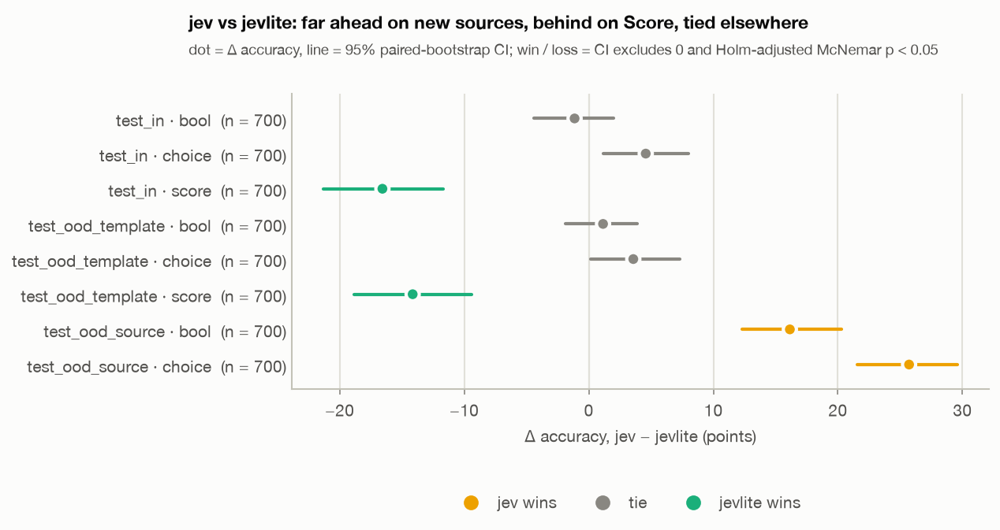
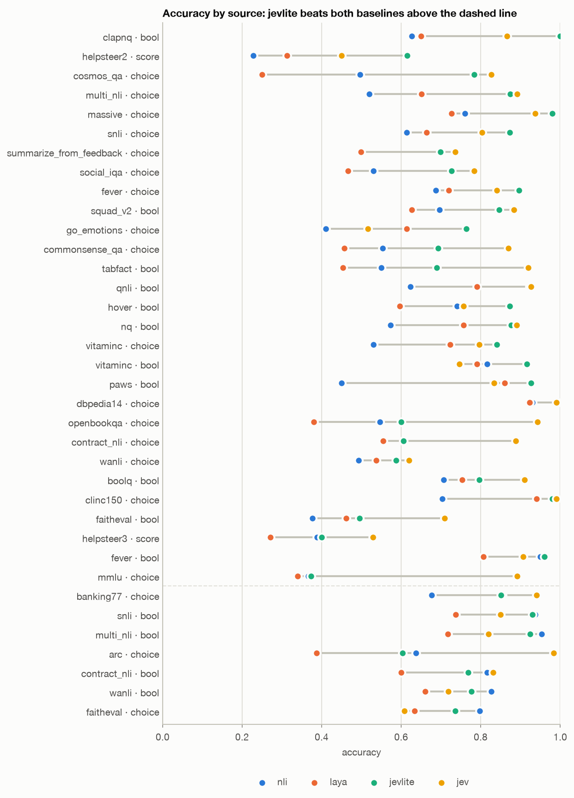
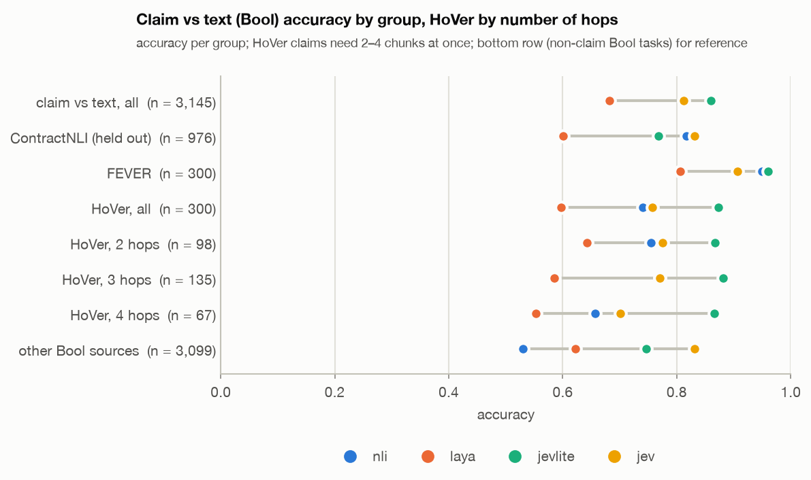
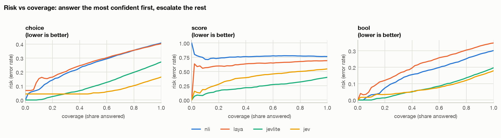
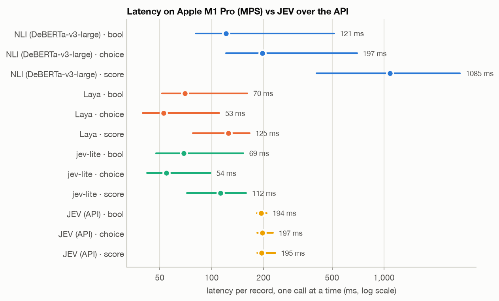

# Part 3. Model test results: Stage A, the JEV API, and Stage B

> jev-lite overview, October 2026 (revised 2026-10-30 for Stage B) · Part 3 of 5 ·
> [← Previous: Data and methodology](02_data_and_methodology.md) · [Index](README.md) ·
> [Next: Judge benchmarks →](04_judge_benchmarks.md)
>
> Sections 6.1–6.6: run `stage_a-full-s42` (= `Nefelim584/jev-lite-stage-a`) on the clean test sets of
> Part 2, section 4.3; full reports `STAGE_A.md`, `STAGE_A_API.md`, `BASELINES.md`. The JEV API was
> compared with Stage A only. Sections 6.7–6.8: Stage B (`stage_b-full-s42-r1`) against Stage A on the
> same records, and the calibration.

## 6. Results

### 6.1 Against the open baselines

Accuracy, **NLI / Laya / jev-lite**, on all 48,457 clean test records:

| | `test_in` (trained) | `test_ood_template` (new wording) | `test_ood_source` (new sources) |
|---|---|---|---|
| Bool | 0.763 / 0.723 / **0.882** | 0.569 / 0.770 / **0.902** | 0.542 / 0.519 / **0.603** |
| Choice | 0.595 / 0.596 / **0.803** | 0.617 / 0.622 / **0.794** | 0.558 / 0.585 / **0.635** |
| Score | 0.242 / 0.309 / **0.620** | 0.234 / 0.315 / **0.591** | — |
| Bool calibration error (ECE, lower is better) | 0.161 / 0.076 / **0.031** | 0.314 / 0.051 / **0.026** | 0.411 / 0.367 / **0.295** |

- **On trained sources and on new wording jev-lite is far ahead**: +12 (Bool), +17–21 (Choice) and
  +28–31 (Score) points over the better baseline, all significant. New question wording costs nothing,
  so the model does not depend on exact templates.
- **On new sources the lead shrinks to +5–6 points** and is not uniform. Over all 61
  source × split cells: against NLI 43 wins, 16 ties, **2 losses** (ContractNLI Bool −4.8, FaithEval
  counterfactual −6.1); against Laya 52 wins, 9 ties, 0 losses.
- **Calibration is excellent on familiar data** (ECE 0.03) and **breaks on new sources** (0.30).

### 6.2 Against the JEV API

JEV (`jev-1.13.0`) on a balanced sample of 5,600 records (700 per split × primitive), plus a top-up to
16,460 records for per-source numbers. Δ = JEV − jev-lite, paired.

| Split | Bool: JEV / jev-lite | Choice: JEV / jev-lite | Score: JEV / jev-lite |
|---|---|---|---|
| `test_in` | 0.853 / 0.864 (tie) | 0.856 / 0.810 (tie) | 0.461 / **0.627** (jev-lite +16.6) |
| `test_ood_template` | 0.891 / 0.880 (tie) | 0.827 / 0.791 (tie) | 0.443 / **0.584** (jev-lite +14.1) |
| `test_ood_source` | **0.763** / 0.601 (JEV +16.1) | **0.884** / 0.627 (JEV +25.7) | — |

*Paired Δ accuracy (JEV − jev-lite) with 95% CI. Amber = JEV wins, green = jev-lite wins, gray = tie.*

- **JEV beats NLI and Laya everywhere.** Against jev-lite it depends on the data: **tied on what
  jev-lite was trained on, far ahead on new sources**, behind on Score (HelpSteer2 rubrics).
- **Per source: 10 wins, 10 losses, 16 ties.** JEV wins on knowledge-heavy multiple choice (MMLU +52,
  ARC +38, OpenBookQA +34), on new faithfulness data (FaithEval +21, ContractNLI +6 / +28) and on
  tables (TabFact +23). jev-lite wins on the entailment and label sets it was trained on (VitaminC +17,
  HoVer +12, MultiNLI +10, go_emotions +25, HelpSteer2 +17).

*Accuracy per source and primitive, all 16,460 records. JEV (amber) leads on most rows; where
jev-lite (green) is ahead of it, the source is one jev-lite was trained on. Below the dashed line
jev-lite does not beat both open baselines.*

### 6.3 Faithfulness: the judge's main criterion

*Bool accuracy on "is this claim supported by the text". jev-lite leads overall (0.86 vs JEV 0.81),
on FEVER and on multi-hop HoVer at every hop count; JEV leads on held-out legal contracts
(ContractNLI, 0.83 vs 0.77).*

- **Multi-hop claims (HoVer, 2–4 documents per claim)** are the closest public proxy for checking an
  answer against several chunks. jev-lite keeps its accuracy as the number of hops grows and catches
  "not supported" in 82–84% of cases (NLI 46%, Laya 25%; JEV 60% on its sample).
- **ContractNLI shows the failure mode on a new domain**: jev-lite *ranks* claims better than NLI
  (AUROC 0.93 vs 0.88), but its probabilities are shifted down, so at the 0.5 threshold it calls half
  of the supported claims unsupported. On a new domain the model is **too strict, not too lenient**.

### 6.4 Calibration and confidence

*Error rate when only the most confident share is answered. Lower and flatter means the confidence separates right from wrong answers better.*

- jev-lite's confidence separates right from wrong answers: on Bool and Choice its error stays near
  zero for the most confident 10–20% and rises slowly; the open baselines' curves rise almost linearly
  from the start.
- On Stage A's full test set, the 80% most confident Bool answers are 0.95 accurate against 0.88 for
  all of them (first-version numbers in `STAGE_A.md` section 5): the confidence tells which verdicts
  to trust.

### 6.5 Behaviour probes

| | NLI | Laya | jev-lite | JEV |
|---|---|---|---|---|
| Answer flips when options are reordered | 0% (by design) | 12.4% | 2.8% | **2.1%** |
| Mass taken by an irrelevant extra option | 0.103 | 0.108 | 0.020 | **0.010** |
| Claim only, no passage: accuracy on FEVER (majority 0.68; should stay at it) | 0.68 | 0.68 | 0.68 | 0.81 |
| Unrelated passage: share "supported" on VitaminC | ≤ 0.10 | — | 0.01 | 0.45 |

- **Option order**: jev-lite and JEV barely depend on it; option shuffling in training worked.
- **JEV answers partly from world knowledge, not from the text.** Without the passage it still gets
  FEVER and BoolQ claims right well above the majority rate, and with an unrelated passage it calls 45%
  of VitaminC claims supported. For a judge that must check an answer *against the retrieved context*
  this is the main risk found in JEV. jev-lite falls to the majority rate without the passage: it reads
  the text.
- **JEV is not deterministic**: the same request twice gave different probabilities for 61 of 100
  records (by up to 0.11), and 2 of 100 answers flipped.

### 6.6 Speed

Apple M1 Pro laptop, one record per call, the same 300 records for every model; JEV's times are API
round trips.

| ms per record | jev-lite | Laya | NLI | JEV (API) |
|---|---|---|---|---|
| median | **73** | 77 | 241 | 195 |
| p90 | **152** | 160 | 1,895 | 224 |

*Dot = median, line = 10th–90th percentile, log scale.*

jev-lite on a laptop GPU is faster than a JEV API call at every input length in the test sets: 4.2×
on the shortest fifth, 1.3× on the longest; no network and no per-call cost. A server GPU would be
faster still. JEV's side scales by running requests in parallel.

Server-GPU numbers for Stage B, including long inputs, are in Part 4, section 7.6.

### 6.7 Stage B against Stage A on the same tests

Stage B was trained on new judge data with a 26% replay of Stage A's data. The question here is what it
forgot. Paired comparison on 47,557 records of the Stage A tests (`test_in` + `test_ood`):

| Primitive | n | Stage A | Stage B | Δ [95% CI] | Verdict |
|---|---|---|---|---|---|
| Bool | 17,358 | 0.883 | 0.870 | −1.3 [−1.7, −0.9] | loss (−0.7 without ClapNQ) |
| Choice | 27,979 | 0.800 | 0.789 | −1.1 [−1.4, −0.7] | loss |
| Score | 2,220 | 0.599 | 0.633 | **+3.4** [+1.8, +5.0] | win |

- **Score improved** (HelpSteer2 +3.3): the rubric criterion (b) of the judge got better.
- **Bool losses are small and expected.** The biggest is ClapNQ, 1.000 → 0.830: the Stage A shortcut
  is gone (Part 2, section 4.6). Then SQuAD 2.0 −2.0 and QNLI −1.8. Faithfulness sources are flat
  (FEVER, HoVer, VitaminC, MultiNLI ties); TabFact +1.2 (tie).
- **Choice lost on reasoning multiple choice** (Cosmos QA −5.2, CommonsenseQA −3.6) and gained on
  WANLI +4.3. These sources are not needed by the judge.
- **On the new sources' own tests** Stage B reaches Bool accuracy from 0.72 (FinQA) to 0.99 (Faithfulness-QA): RAGBench 0.90, HotpotQA 0.91,
  TAT-QA 0.87, Qasper 0.79; 0.90 on Trust-Data pairs. These sources are
  in-distribution; the honest test is the held-out judge benchmarks of Part 4.
- **Choice became overconfident**: mean confidence 0.91 at accuracy 0.80, ECE 0.05 → 0.11. The
  replayed Choice records were seen for the 3rd–4th time (train accuracy 0.97). Calibration fixes it
  (next section).

### 6.8 Calibration

The model layer of the calibration (Part 2, section 5.2) on the same Stage A tests, which it was not
fitted on. Answers do not change, so accuracy is the same; only the probabilities move:

| Primitive | ECE `test_in`: raw → calibrated | ECE `test_ood`: raw → calibrated | Log loss `test_ood` |
|---|---|---|---|
| Bool | 0.058 → **0.014** | 0.068 → **0.033** | 0.37 → 0.32 |
| Choice | 0.115 → **0.026** | 0.113 → **0.024** | 0.72 → 0.56 |
| Score | 0.086 → **0.036** | 0.095 → **0.032** | 0.95 → 0.90 |

After calibration, "the model says 80%" means about 80% again on all three primitives, which is what
any decision threshold on the probabilities relies on. The effect of the optional judge layer on the judge
benchmarks is in Part 4, section 7.4.

[Next: Judge benchmarks →](04_judge_benchmarks.md)
