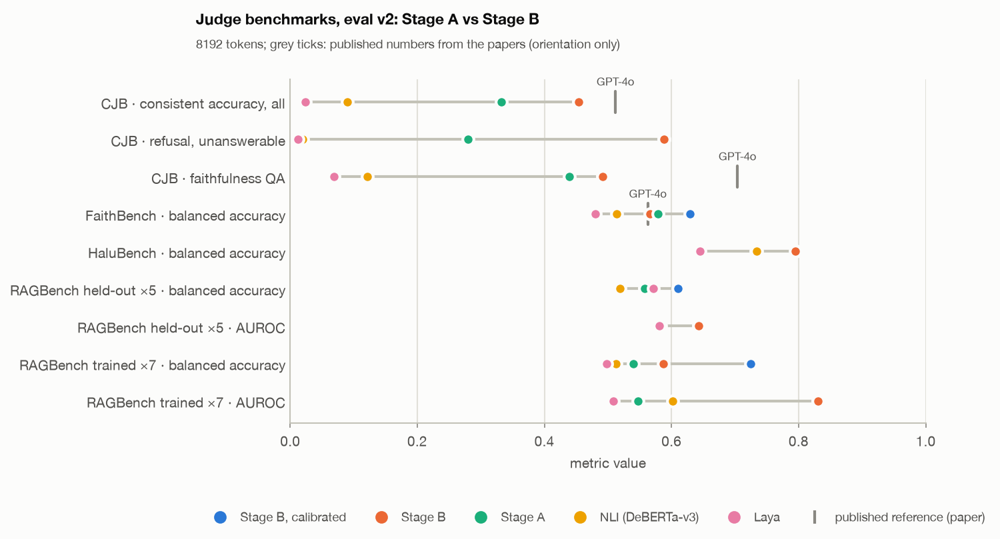
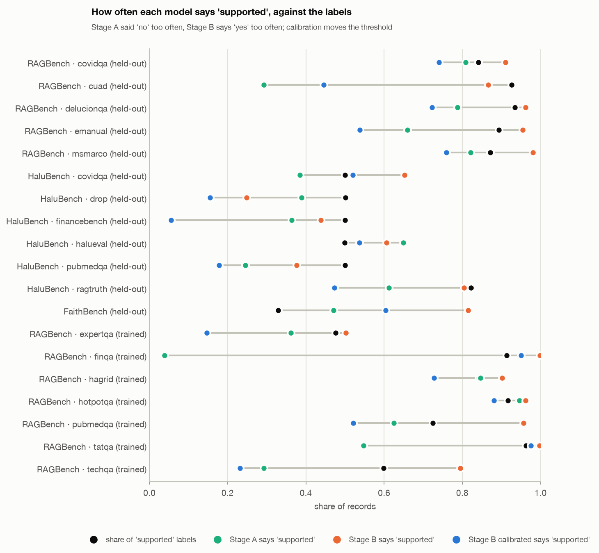

# Part 4. Judge benchmarks

> jev-lite overview, October 2026 (revised 2026-10-30 for Stage B) · Part 4 of 5 ·
> [← Previous: Model test results](03_stage_a_results.md) · [Index](README.md) ·
> [Next: Known issues, targets and roadmap →](05_issues_and_next.md)
>
> Stage A, Stage B, NLI and Laya on four public judge benchmarks (Part 2, section 4.4), on the frozen
> **eval v2**: the **held-out slice** (never trained on by any stage, ~21,000 records) and, separately,
> the 7 RAGBench subsets Stage B trained on. jev-lite runs untruncated at 8192 tokens unless noted;
> "calibrated" = Stage B with both calibration layers (Part 2, section 5.2). LLM numbers come from the
> benchmarks' papers, not from our runs. Full report for Stage A: `JUDGE_BENCH.md`.

## 7. Results

### 7.1 Headline

*Headline metric per benchmark, five runs. Where calibration does not change the metric (pairwise
Choice, AUROC, HaluBench overall) the calibrated dot sits under the Stage B dot. Grey ticks: published
numbers from the papers (other prompts and label versions, orientation only).*

| Benchmark · metric (held-out) | Stage A | Stage B | Stage B calibrated | NLI | Laya | Published LLM judges |
|---|---|---|---|---|---|---|
| CJB · pairwise consistent accuracy (random 0.25) | 0.332 | **0.454** | 0.454 | 0.090 | 0.024 | 8B judges 0.32–0.44, GPT-4o 0.512, o1 0.631 |
| CJB · refusal on unanswerable | 0.280 | **0.588** | 0.588 | 0.020 | 0.012 | |
| CJB · faithfulness QA | 0.440 | **0.492** | 0.492 | 0.121 | 0.069 | 8B judges 0.31–0.39, GPT-4o 0.704 |
| FaithBench · balanced accuracy | 0.579 | 0.566 | **0.629** | 0.514 | 0.480 | GPT-4o 0.563, GPT-4-Turbo 0.577 |
| FaithBench · AUROC | 0.619 | **0.681** | 0.681 | 0.481 | 0.506 | |
| HaluBench · balanced accuracy | 0.732 | **0.795** | **0.796** | 0.734 | 0.645 | GPT-4o 0.865 accuracy (vendor-reported) |
| HaluBench without HaluEval (seen source) | 0.641 | **0.662** | 0.638 | 0.613 | 0.530 | |
| RAGBench ×5 held-out · balanced accuracy | 0.558 | 0.558 | **0.610** | 0.519 | 0.571 | |
| RAGBench ×5 held-out · AUROC | 0.583 | **0.643** | 0.643 | 0.578 | 0.580 | |
| RAGBench ×7 trained · balanced accuracy | 0.540 | 0.587 | **0.725** | 0.513 | 0.498 | |
| RAGBench ×7 trained · AUROC | 0.547 | **0.831** | 0.831 | 0.601 | 0.509 | fine-tuned DeBERTa 0.79 (paper, all 12) |

In one line: **Stage B is better than Stage A on every held-out benchmark in ranking (AUROC) and on
pairwise judging, where it now sits between 8B LLM judges and GPT-4o; with calibration it is also
ahead on balanced accuracy for RAG answers and summaries.** The trained RAGBench subsets show what the
model can do once it has seen a domain: AUROC 0.55 → 0.83.

### 7.2 Per benchmark

- **ContextualJudgeBench (pairwise: which answer is better).** The largest gain of Stage B. Refusals
  doubled: 0.28 → 0.59 when the right answer is "the context does not say", 0.46 → 0.61 when it is to
  answer. Completeness 0.32–0.43 → 0.53. Faithfulness QA 0.44 → 0.49. Conciseness is still the weakest
  (0.20–0.29): with both answers visible the model still prefers the longer one, despite the
  conciseness pairs in training.
- **FaithBench (subtle summary hallucinations, adversarially selected).** Ranking improved (AUROC 0.62
  → 0.68), but raw Stage B says "faithful" to 81% of summaries where only 33% are, so balanced accuracy
  did not move (0.58 → 0.57). With calibration it is **0.629**, above the GPT-4-class zero-shot detectors
  in the paper (0.53–0.58).
- **HaluBench.** Overall 0.73 → 0.80, but two thirds of it is HaluEval, built on HotpotQA, which Stage B
  trains on (0.79 → 0.87 there). On the rest Stage B gains +2.1 points (0.64 → 0.66). Long medical
  contexts (CovidQA) are the strongest unseen part (0.79, 0.84 calibrated); records that need
  arithmetic (DROP, FinanceBench) stay near chance for every model.
- **RAGBench, held-out subsets.** Balanced accuracy equal to Stage A at the 0.5 threshold, AUROC
  +0.06; calibrated +5.2 points [+1.3, +9.2]. MS MARCO (never trained, not used for calibration either)
  gains most: +10.6 [+4.0, +17.1].
- **RAGBench, trained subsets.** The table problem of Stage A is solved in ranking: FinQA AUROC 0.49 →
  0.72, TAT-QA 0.61 → 0.78; Stage A said "supported" to 4% of FinQA answers (labels: 91%), Stage B to
  99.8%. These are in-distribution numbers.

### 7.3 Stage A was too strict, Stage B is too lenient

*Share of "supported" answers per subset against the label rate (black). Stage A (green) said "no" too
often on RAG answers; Stage B (orange) says "yes" too often; calibrated Stage B (blue) moves back below
the labels on RAG answers, and too far on short factual QA (HaluBench DROP, PubMedQA, FinanceBench).*

Stage B calls 93% of held-out RAGBench answers supported and catches only 18–20% of the unsupported
ones; on FaithBench 81% vs 33%. Its ranking is good, so the problem is the decision threshold, which is
exactly what the judge layer of the calibration moves.

### 7.4 Calibration on the judge benchmarks

Judge layer on top of Stage B, paired bootstrap of balanced accuracy on the held-out slice (the layer
was fitted on other records of the four RAGBench held-out subsets; MS MARCO and FaithBench are fully
independent of it):

| Slice | Stage B | Calibrated | Δ [95% CI] |
|---|---|---|---|
| FaithBench | 0.566 | 0.629 | **+6.3** [+3.4, +9.1] |
| RAGBench MS MARCO | 0.521 | 0.627 | **+10.6** [+4.0, +17.1] |
| RAGBench ×5 | 0.558 | 0.610 | **+5.2** [+1.3, +9.2] |
| HaluBench, all | 0.795 | 0.796 | +0.1 [−0.4, +0.6] |
| HaluBench HaluEval / CovidQA | 0.865 / 0.794 | 0.884 / 0.838 | +2.0 / +4.4 |
| HaluBench DROP / PubMedQA | 0.542 / 0.672 | 0.507 / 0.608 | **−3.5 / −6.4** |

**One threshold does not fit all domains.** On long RAG answers and summaries Stage B is lenient and
the shift helps; on short factual QA it is already strict and the shift hurts. For the product this
means: the threshold must be fitted on our own labelled answers (Part 5), and possibly per domain.
Ranking is untouched by calibration, so the AUROC numbers above hold either way.

### 7.5 Long context: training length vs 8192 tokens

Neither stage was trained beyond 1024 tokens; both run at 8192 without retraining.

- **Stage A, 512 → 8192**: better wherever the evidence was being cut: HaluBench CovidQA AUROC 0.55 →
  0.85, CJB faithfulness QA 0.29 → 0.44, overall Bool accuracy +3.7 (paired).
- **Stage B, 1024 → 8192**: long medical contexts need the full input (HaluBench CovidQA 0.62 → 0.79).
  But on CJB the 1024-token run is *better* overall (0.479 vs 0.454), most on faithfulness of summaries
  (0.51 vs 0.40) and conciseness: on very long inputs the model has not learned what to look at.
  Long-context training (Stage C) is the fix; until then 1024 tokens is the safer default for pairwise
  judging.

### 7.6 Response time

**Target: ≤ 100 ms per request at the maximum context of 8,192 tokens**, on the serving GPU, without
shrinking the model (Part 5, section 9.1). All times below are **ms per question**: wall time of a call
divided by the questions in it, one question per call for jev-lite and Laya. Kaggle **T4** GPU, fp16,
the held-out slice of eval v2 (21,074 records); input length = question + options + context in
ModernBERT tokens.

**Overall, ms (p50 / p95 / mean):**

| Model · max input | p50 | p95 | mean | Inputs cut |
|---|---|---|---|---|
| Stage B · 8192 | 37 | 479 | 102 | 1% (over 8k) |
| Stage B · 1024 | 38 | 92 | 50 | 18% (over 1k) |
| Stage B · 512 | 36 | 50 | 38 | 32% (over 512) |
| Stage A · 8192 | 37 | 558 | 112 | 1% |
| NLI (DeBERTa-v3, own limit) | 29 | 118 | 43 | most long inputs |
| Laya (own limit) | 36 | 51 | 39 | most long inputs |

**By input length, ms (p50 / p95 / mean):**

| Input tokens | Records | Stage B · 8192 | Stage B · 1024 | Stage A · 8192 | NLI | Laya |
|---|---|---|---|---|---|---|
| ≤ 512 | 14,329 | 35 / 42 / 35 | 36 / 45 / 36 | 35 / 46 / 36 | 13 / 87 / 25 | 34 / 44 / 35 |
| 513–1k | 2,868 | 61 / 84 / 61 | 65 / 90 / 67 | 66 / 92 / 67 | 59 / 118 / 78 | 48 / 51 / 46 |
| 1–2k | 2,047 | 112 / 166 / 117 | 90 / 95 / 89 * | 125 / 185 / 129 | 109 / 119 / 91 | 49 / 52 / 47 |
| 2–4k | 859 | 334 / 488 / 336 | 84 / 96 / 87 * | 384 / 572 / 386 | 60 / 119 / 76 | 44 / 54 / 46 |
| 4–6k | 565 | 723 / 948 / 733 | 84 / 99 / 86 * | 822 / 1,104 / 842 | 60 / 119 / 67 | 49 / 58 / 50 |
| 6–8k | 175 | **1,167 / 1,526 / 1,195** | 101 / 106 / 96 * | 1,315 / 1,707 / 1,351 | 100 / 122 / 94 | 60 / 63 / 58 |
| > 8k (cut to 8k) | 231 | 1,366 / 1,394 / 1,372 | 89 / 118 / 94 * | 1,537 / 1,561 / 1,542 | 65 / 121 / 72 | 71 / 132 / 83 |

\* the input is cut to 1,024 tokens, so the time stays flat but the model does not see the rest. NLI
and Laya cut long inputs too, and NLI's times are amortised over batches of 64 (throughput, not
latency).

**Against the target, Stage B, ms:**

| | Typical judge input (≤ 2k tokens, 91% of records) | Max context (6–8k tokens) |
|---|---|---|
| T4 now, p50 | 35–112 | 1,167 |
| T4 now, p95 | 42–166 | 1,526 |
| Target | ≤ 100 | **≤ 100** |
| Gap | met up to ~1k tokens | **~12×** |

- **Typical judge inputs are already fast**: a question, an answer and a few chunks are under 2k tokens
  and take 35–112 ms on a T4.
- **Long inputs are the problem**: time grows faster than linearly with length (attention), 1.2 s at
  6–8k tokens. Stage B is ~10% faster than Stage A at the same length; the model size is the same, so
  this is most likely a difference between Kaggle sessions.
- **How to close the ~12× gap** without shrinking the model (Part 5, roadmap step 2): a server GPU (H100
  on paper ~15× a T4 in fp16/bf16 compute and ~10× in memory bandwidth; real gains are lower),
  FlashAttention 2 and unpadded sequences (ModernBERT supports
  both; the T4 cannot run FlashAttention 2), bf16, compiled inference (`torch.compile` or TensorRT).
  This is an estimate; it is measured on the target GPU before any serving decision.
- **Laptop, for reference** (Stage A, Apple M1 Pro, the same 300 test records for every model, Part 3, 6.6):
  jev-lite 73 ms median / 152 ms p90; the JEV API 195 / 224 ms per call (network round trip included).

### 7.7 Plain accuracy misleads

On RAGBench 86–89% of the labels are "supported". NLI reaches accuracy 0.87 on the held-out RAGBench
subsets by saying "supported" to 96% of the records, and raw Stage B 0.86 by saying it to 93%. Neither
catches unsupported answers. When the labels are skewed, only balanced accuracy and AUROC compare
judges fairly, and they are what this part reports.

[Next: Known issues, targets and roadmap →](05_issues_and_next.md)
