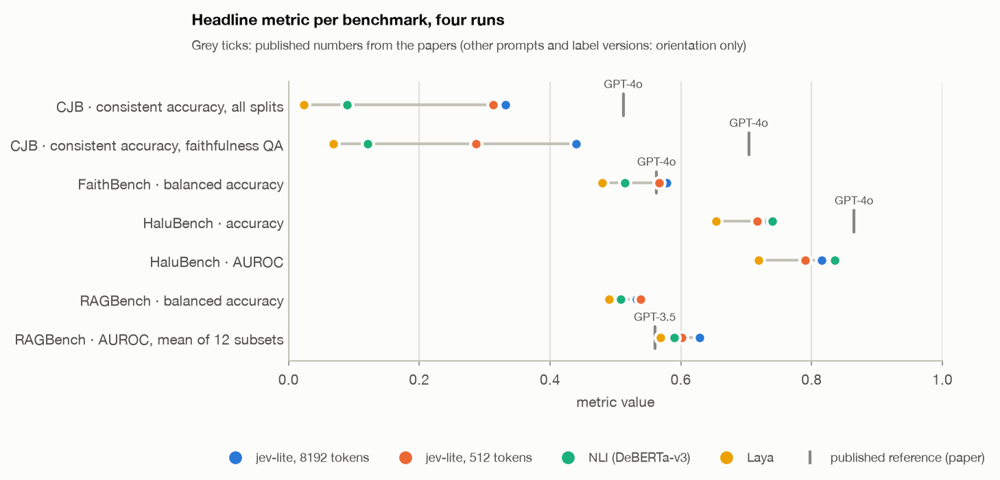
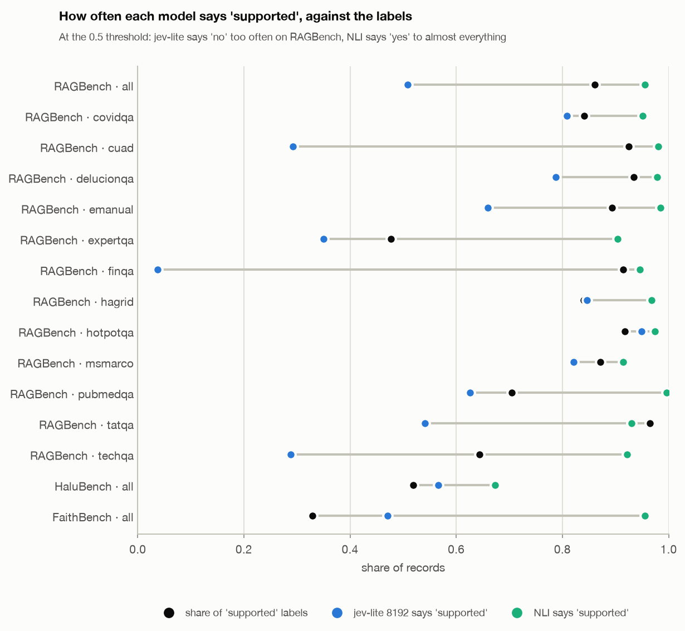
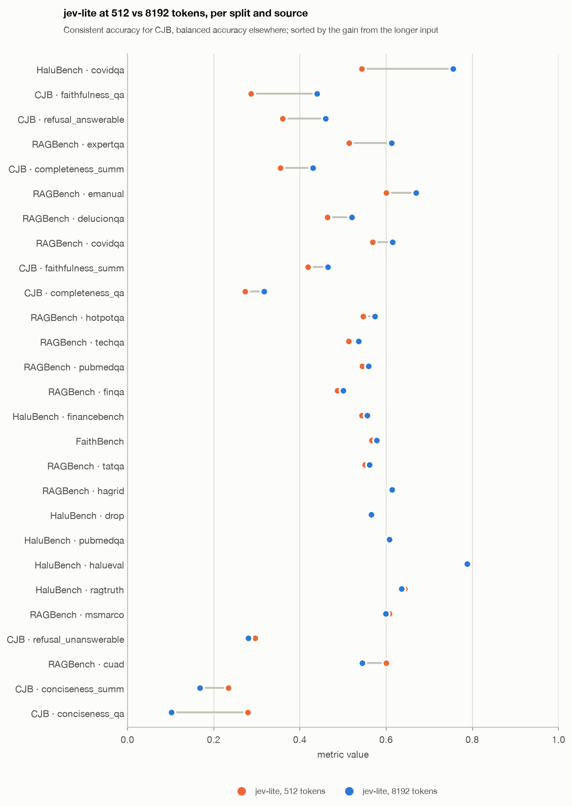

# Part 4. Judge benchmarks

> jev-lite overview, October 2026 · Part 4 of 5 ·
> [← Previous: Stage A results](03_stage_a_results.md) · [Index](README.md) ·
> [Next: Known issues and next steps →](05_issues_and_next.md)
>
> The same Stage A model, NLI and Laya on four public judge benchmarks (Part 2, section 4.3), none of
> them trained on. jev-lite runs twice: at 512 tokens (its training length, longer inputs truncated) and
> at 8192 (untruncated). LLM numbers come from the benchmarks' papers, not from our runs. Full report:
> `JUDGE_BENCH.md`.

## 7. Results

### 7.1 Headline

*Headline metric per benchmark. Grey ticks: published numbers from the papers (other prompts and
label versions, orientation only).*

| Benchmark · metric | jev-lite 8192 | NLI | Laya | Published LLM judges |
|---|---|---|---|---|
| CJB · pairwise consistent accuracy (random 0.25) | **0.332** | 0.090 | 0.024 | 8B judges 0.32–0.44, GPT-4o 0.512, o1 0.631 |
| CJB · faithfulness QA | **0.440** | 0.121 | 0.069 | 8B judges 0.31–0.39, GPT-4o 0.704 |
| FaithBench · balanced accuracy | **0.579** | 0.514 | 0.480 | GPT-4o 0.563, GPT-4-Turbo 0.577 |
| HaluBench · accuracy | 0.735 | **0.740** | 0.654 | GPT-4o 0.865 (vendor-reported) |
| RAGBench · AUROC, mean of 12 domains | **0.629** | 0.590 | 0.569 | GPT-3.5 judge 0.56, RAGAS 0.60, fine-tuned DeBERTa 0.79 |

In one line: **far ahead of the open baselines on pairwise judging, at the level of 8B LLM judges
there and of GPT-4-class detectors on FaithBench, a tie with NLI on HaluBench, and 15–30 points behind
frontier judges on most metrics.**

### 7.2 Per benchmark

- **ContextualJudgeBench (pairwise: which answer is better).** Faithfulness is the strongest criterion
  (0.44–0.47, above the 8B judges), conciseness the weakest (0.10–0.17): with both answers visible the
  model prefers the longer, more complete one. Almost no pairwise data was in training, so this is
  transfer from Bool / Choice.
- **FaithBench (subtle summary hallucinations, adversarially selected).** 0.579 balanced accuracy, in
  the range of GPT-4-class zero-shot detectors (0.53–0.58). NLI and Laya say "supported" to 89–96% of
  the summaries and are at chance.
- **HaluBench.** Two thirds of it is HaluEval, where jev-lite and NLI are equal (AUROC 0.88 vs 0.89).
  jev-lite wins on long contexts (CovidQA, at 8192 only) and RAGTruth; NLI wins on PubMedQA. Records
  that need arithmetic (DROP, FinanceBench) are near chance for every model.
- **RAGBench: the weakest result.** Prose QA works (AUROC 0.69–0.74 on five domains, ahead of NLI).
  Answers with **numbers computed from tables** fail: on FinQA jev-lite says "supported" to 4% of
  answers where the labels say 91%. The answer states a derived value, the text has no literal match,
  and the model calls it unsupported.

*Share of "supported" answers per RAGBench domain against the label rate. jev-lite is too sceptical on
contracts (cuad), technical docs and finance tables.*

### 7.3 Plain accuracy misleads

On RAGBench 86% of the labels are "supported". NLI reaches accuracy 0.83 by saying "supported" to 96%
of the records, which would make jev-lite look 31 points worse. Balanced accuracy and AUROC put
jev-lite ahead. When the labels are skewed, only balanced metrics compare judges fairly.

### 7.4 Long context: 512 vs 8192 tokens

*The same model at its training length (512 tokens, inputs truncated) and at 8192 (untruncated).*

Stage A was trained at 512 tokens only. Run at 8192 without any long-context training, it is better
wherever the evidence was being cut: HaluBench CovidQA AUROC 0.55 → 0.85, CJB faithfulness QA
0.29 → 0.44, overall Bool accuracy +3.7 (paired). The exception is conciseness (see 7.2). The encoder
generalises well beyond its training length, so long-context training starts from a usable model. The
cost is throughput: 9.3 vs 27 records/s on a T4.

[Next: Known issues and next steps →](05_issues_and_next.md)
